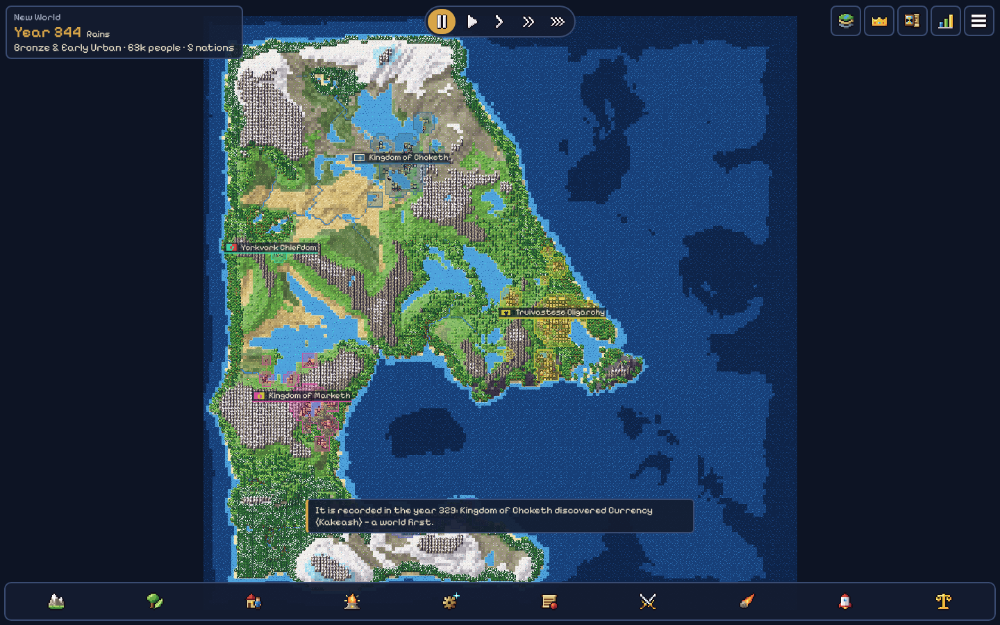
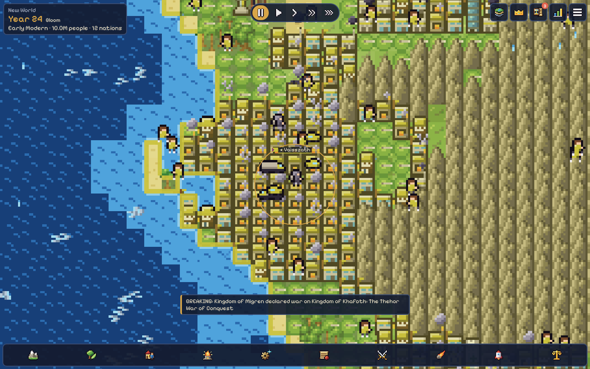
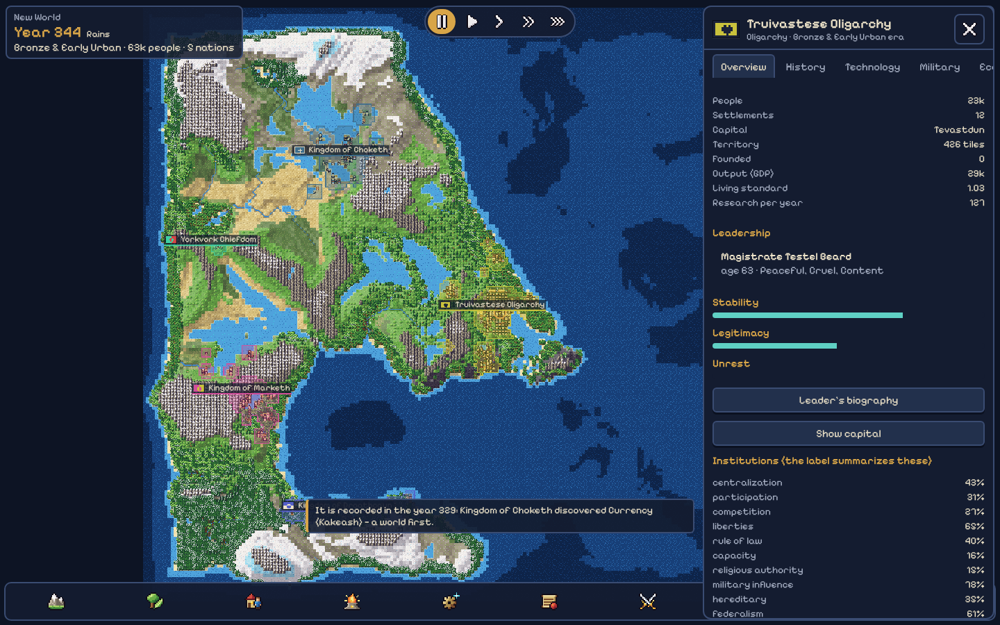
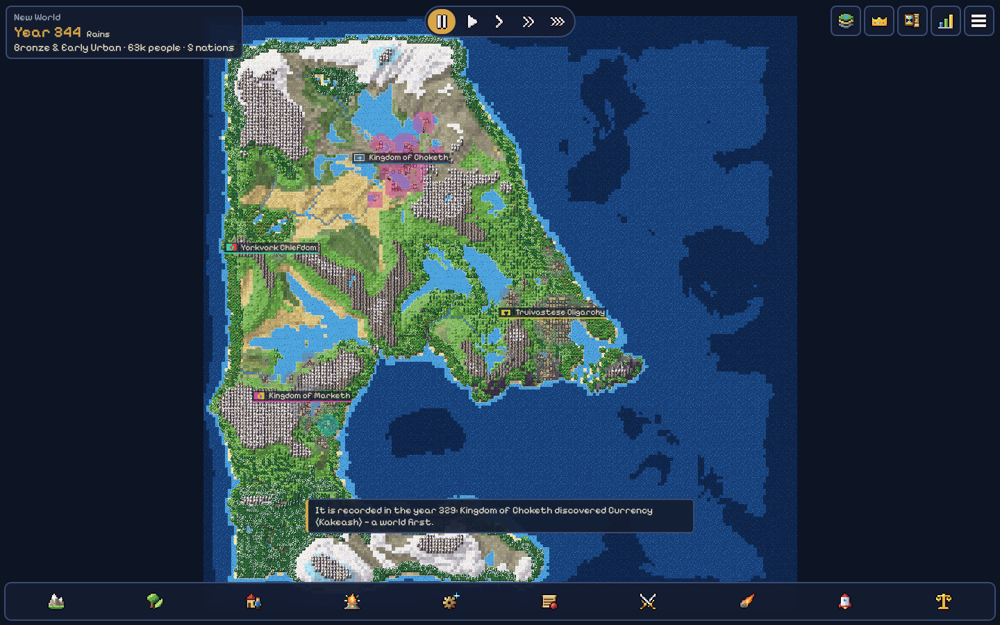
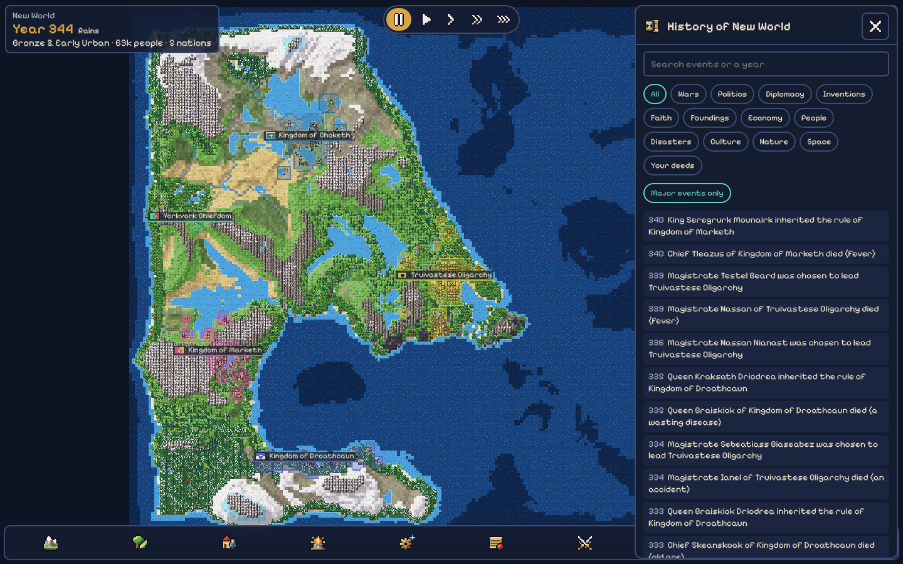
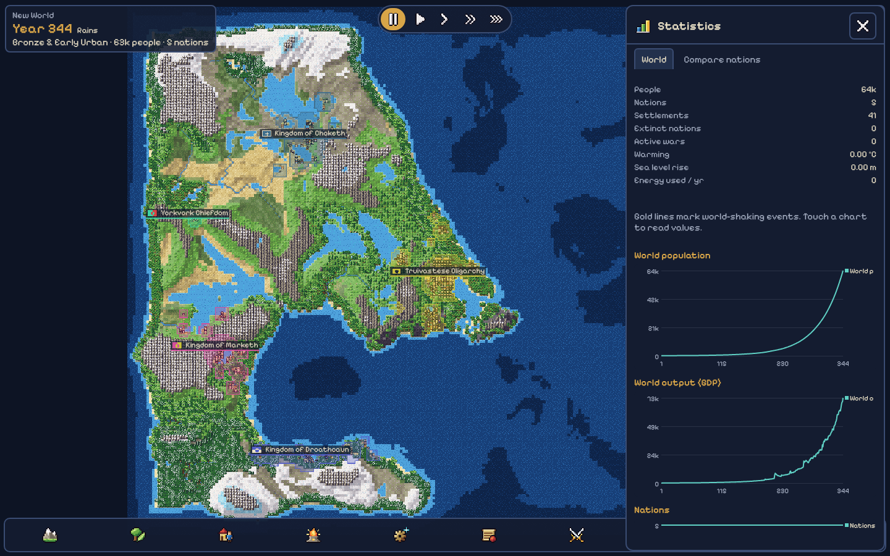
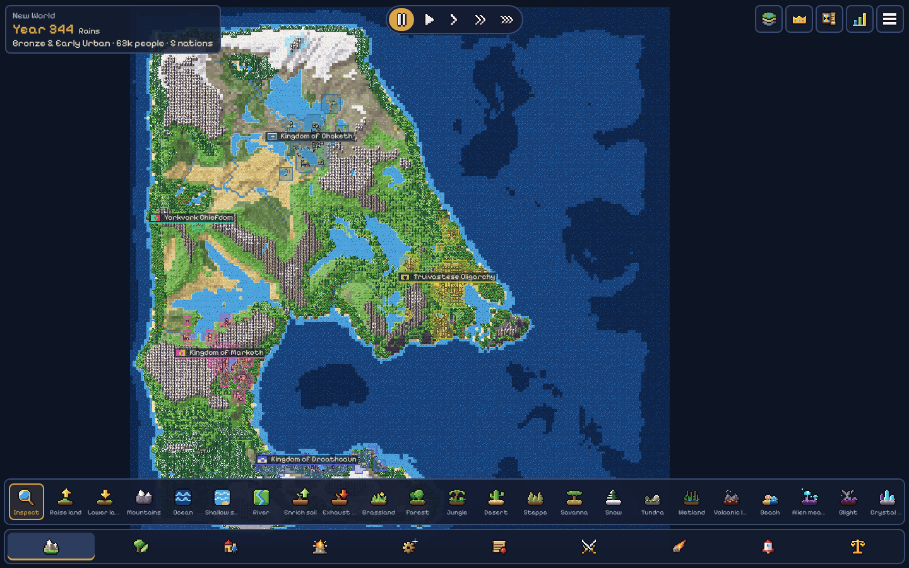
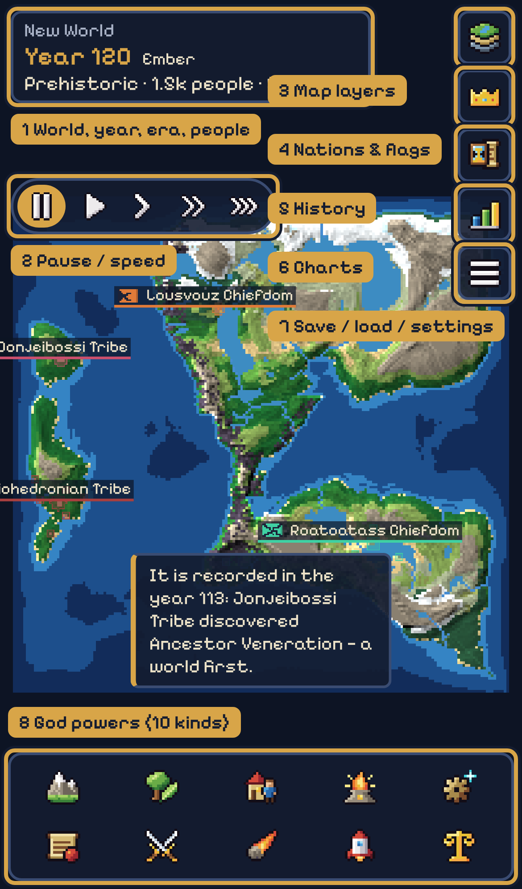
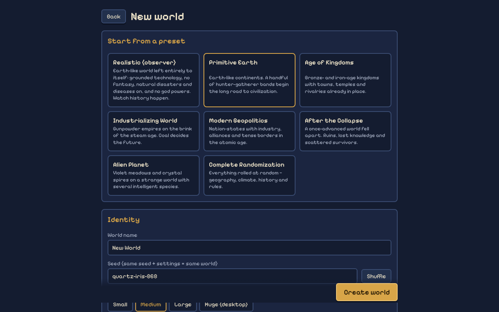

<div align="center">


# EPOCH: Civilizations Unbound

**A pixel-art world simulator.** Shape a planet, then watch peoples grow from wandering hunter-gatherers into kingdoms, empires, industrial nations and spacefaring civilizations. Nothing is scripted: every war, faith, invention, famine and revolution comes from the simulation itself, and the game tells you *why* it happened.

Runs in the browser on **iPhone, iPad, Android and PC**, with nothing to install.



</div>

---

## Contents

1. [What you can do](#what-you-can-do)
2. [Play on iPhone](#play-on-iphone)
3. [Play on a PC or Mac](#play-on-a-pc-or-mac)
4. [Publish your own copy online (GitHub Pages)](#publish-your-own-copy-online-github-pages)
5. [Controls](#controls)
6. [Is it really realistic? (verification)](#is-it-really-realistic)
7. [For developers](#for-developers)

---

## What you can do

### Watch civilizations rise on their own

Every world is generated from a seed: continents, mountains, rivers, climates, animals and mineral deposits. A few bands of foragers start out; with time they settle, farm, found cities and nations, and advance through **15 eras**, from *Prehistoric* to *Spacefaring*. Each nation advances at its own pace.

| Iron age to medieval | Early modern |
|---|---|
|  |  |

### Nations with flags, rulers and people with life stories

Every nation gets its own generated flag, government, culture, language and religion. Rulers and notable people grow skills, earn traits from what happens to them (a *veteran* after battles, *beloved* after a just reign, *scarred* after a defeat) and keep a dated life story.

| Nations and flags | A nation | A ruler's biography |
|---|---|---|
|  |  |  |

### See the world in 16 map layers

Nations, population, technology, religion, culture, language, resources, economy, trade, military, diplomacy, pollution, climate and infrastructure. There is also **Past borders**, which has a year slider so you can scrub back through history.

| Religions | Past borders (with a year slider) |
|---|---|
|  |  |

### Read the history and the numbers

Every event is recorded with its causes. Charts show population, economy, technology and more, and every number is calculated from the simulation, never invented.

| History | Statistics |
|---|---|
|  |  |

### Play god, or just watch

**97 god powers** come in 10 groups: shape land, plant forests, place peoples, found faiths, grant knowledge, start or end wars, call down disasters, launch the space age, and change the **world laws**. You can also edit any person's traits ("divine touch").

Prefer to just watch? Choose the **Realistic (observer)** preset. God powers are switched off and history runs entirely on its own, including natural disasters and epidemics.

| God powers | Observer mode |
|---|---|
|  |  |

### Save, load, branch and share

Your worlds are saved in your browser, with autosave. You can export a world as a `.epoch` file to back it up or share it, and **branch** a world to explore an alternative timeline. A loaded save continues *exactly* the same history.

---

## Play on iPhone

> These screenshots come from the game running in a phone-sized browser window. On a real iPhone it looks the same.

### Option A: Open the web link (easiest)

1. Open **Safari** on your iPhone.
2. Go to the game's address. If you use this repository's GitHub Pages, that's
   **`https://jviola1019.github.io/worldsim/`**. Pages must be switched on once first: see [Publish your own copy online](#publish-your-own-copy-online-github-pages).
3. Tap **New world**, then **Create world**.
4. Tap the **fastest play button** (▸▸▸) at the top and watch history unfold.

| ① Title screen | ② Choose a starting point | ③ Your world, explained |
|---|---|---|
|  |  |  |

**Make it feel like an app:** in Safari, tap the **Share** button (the square with an arrow), scroll down, tap **Add to Home Screen**, then tap **Add**. An EPOCH icon appears on your home screen and the game opens full screen.

### Option B: From your own computer over home Wi-Fi (no internet publishing)

1. Set up the game on your PC or Mac first (see [Option B below](#option-b-run-it-on-your-own-computer)).
2. In the terminal, type `npm run dev:lan` and press Enter.
3. The terminal shows a line like `Network: http://192.168.1.23:5173/`.
4. On your iPhone, connected to the **same Wi-Fi**, type that address into Safari.

---

## Play on a PC or Mac

### Option A: Open the web link

Open the game's address in **Chrome, Edge, Firefox or Safari**, then click **New world → Create world**.

**Install it like an app (Chrome or Edge):** click the small *Install* icon at the right end of the address bar (a monitor with a down arrow), then click **Install**. EPOCH gets its own window and a desktop icon.


### Option B: Run it on your own computer

Use this if there's no web link, or if you want to play offline. It takes about five minutes the first time.

1. **Install Node.js.** Go to **nodejs.org**, download the **LTS** version, and run the installer, clicking *Next* through it.
2. **Download the game.** On the GitHub page, click the green **Code** button, then **Download ZIP**. Unzip it, for example on your Desktop.
3. **Open a terminal in that folder.**
   - **Windows:** open the unzipped folder, right-click an empty space, and choose **Open in Terminal**.
   - **Mac:** open **Terminal**, type `cd ` (with a space), drag the folder into the window, and press Enter.
4. **Type these two commands**, pressing Enter after each:
   ```bash
   npm install
   npm run dev
   ```
5. **Open the game.** Open your browser and go to **http://localhost:5173**.

To stop the game, click the terminal and press **Ctrl + C**. Next time, only steps 3, 4 (`npm run dev` only) and 5 are needed.

| ① Title screen | ② New world |
|---|---|
|  |  |

---

## Publish your own copy online (GitHub Pages)

This repository includes an automatic publishing workflow (`.github/workflows/pages.yml`). Every time `main` changes, it tests the game, builds it and publishes it.

**One-time setup, about 2 minutes:**

1. On GitHub, open the repository and click **Settings**.
2. In the left menu, click **Pages**.
3. Under **Build and deployment → Source**, choose **GitHub Actions**.
4. Click the **Actions** tab, then **Deploy to GitHub Pages** in the left list, then **Run workflow** (or merge your work into `main`).
5. When it finishes (green tick), the link appears on the workflow page and under **Settings → Pages**:
   `https://<your-username>.github.io/<repository-name>/`.

> **Notes**
> - GitHub Pages on a *private* repository needs a paid GitHub plan. Public repositories are free.
> - By default, GitHub only publishes from the main branch. To publish from another branch, either merge into `main` or allow that branch under **Settings → Environments → github-pages**.
> - The published game makes no network calls of its own; saves stay on each player's device. The only outside request is the Google Fonts pixel font.

---

## Controls

| | Touch (iPhone/iPad) | Mouse and keyboard (PC) |
|---|---|---|
| Move the map | Drag with one finger | Drag; or right or middle button; or hold **Space** and drag |
| Zoom | Pinch with two fingers | Mouse wheel |
| Inspect a town, nation, army or animal | Tap it (press and hold for details) | Click it |
| Use a god power | Pick it in the bottom dock, then tap or paint | Same, with the mouse |
| Move the map while painting | Use **two fingers** (they always move the map, never paint) | Right or middle button |
| Undo a terrain edit | **Undo** in the dock | Same |
| Speed | Buttons at the top: pause, 1× to max | Same |

The numbered pictures above ([iPhone](docs/images/guide-iphone.png), [desktop](docs/images/guide-desktop.png)) label every button on screen.

---

## Is it really realistic?

The simulation is a game, but it is built to be **internally consistent** and **checked against itself**:

- **Natural history with no player at all.** In 1,000-year runs with zero god powers (128² map), nations went from foragers to farming (around year 150–190), to the Middle Ages (around 400), to industry (around 480–540) and to the atomic and digital eras (around 680–970). Over each 1,000 years there were also 26–45 notable natural disasters (earthquakes, storms, floods, volcanoes), 128–400 deadly epidemics, droughts, and sea-level rise from emergent climate warming. Method: [`scripts/modernization.ts`](scripts/modernization.ts).
- **People are never created or lost by accident.** A population ledger accounts for every birth, death, migration, conquest and rounding, exactly, at every moment of the simulation.
- **The economy adds up.** GDP equals consumption + investment + government + net exports + inventory change, in every nation and every year.
- **Saves reproduce the future.** A world saved and reloaded continues the identical history for decades, which is checked automatically.
- **Hostile save files are refused safely.** Malformed or oversized imports are rejected without touching your saved worlds.
- **Cause and effect are tested** with twin worlds that differ in one thing only. Examples: a drought raises food prices; an embargo hurts the nation that depended on it; schooling raises research; electricity enables power plants.

What is still simplified or limited is listed openly in [docs/STATUS.md](docs/STATUS.md). The biggest open item is that late-era worlds stay food-limited and short of metal, which keeps modern economies weak and unemployment high.

---

## For developers

TypeScript 5.9, Vite 7, Preact 10, Canvas2D, Vitest. The only runtime dependency is Preact.

| Command | What it does |
|---|---|
| `npm install` | Install dependencies |
| `npm run dev` / `npm run dev:lan` | Dev server on localhost / also on your LAN (for phones) |
| `npm run build` | Type-check and build the static site into `dist/` |
| `npm run preview` / `npm run preview:lan` | Serve the built site on port 4173 |
| `npm test` | 128 unit, integration, counterfactual, round-trip and security tests (about 1 minute) |
| `npm run e2e` | Browser smoke test (iPhone 13 emulation and desktop); needs `npm run preview` running |
| `node tools/viewports.mjs` | Layout check on 6 device sizes |
| `npm run stats -- 20 600 96` | 20-seed statistics with invariant checks |
| `npx tsx scripts/modernization.ts <seed> 1000 128 [realistic]` | Natural-history run: era timeline, modernization indicators, natural hazards |
| `npm run bench -- 128 900` | Simulation speed per simulated year |
| `node tools/gallery.mjs`, `node tools/guide.mjs` | Regenerate the README screenshots |

**Continuous integration:** `.github/workflows/ci.yml` runs typecheck, tests, build and the browser test on every push. `long-run.yml` runs weekly long simulations, and `pages.yml` publishes the game.

### Documentation

| Document | Contents |
|---|---|
| [STATUS.md](docs/STATUS.md) | What is complete, partial, experimental or missing; bug ledger; ranked next steps |
| [VALIDATION.md](docs/VALIDATION.md) | How everything was verified: tests, seeds, twin-world experiments, long runs, browsers |
| [ARCHITECTURE.md](docs/ARCHITECTURE.md) | Modules, tick model, data model, determinism rules, population ledger, saves |
| [MODEL.md](docs/MODEL.md) | Every simulation assumption, labelled evidence-informed, stylized or speculative |
| [PERFORMANCE.md](docs/PERFORMANCE.md) | Measured speed and memory, with how to reproduce them |
| [SECURITY.md](docs/SECURITY.md) | Security and save-file review |
| [FEATURES.md](docs/FEATURES.md) | Comparison with the genre reference (WorldBox) |
| [ASSETS.md](docs/ASSETS.md) | Every sprite family: all art is generated by code in this repository |
| [REQUIREMENTS.md](docs/REQUIREMENTS.md) | The numbered requirements (R0–R17) |

**Original work.** The genre reference is WorldBox; no code, art, names or layouts were copied. All pixel art is generated by code in this repository.

**License:** MIT.
