<div align="center">


# EPOCH: Civilizations Unbound

**A pixel-art world simulator.** Shape a planet, then watch peoples grow from wandering hunter-gatherers into kingdoms, empires, industrial nations and spacefaring civilizations. Nothing is scripted: every war, faith, invention, famine and revolution comes from the simulation itself, and the game tells you *why* it happened.

Runs in the browser on **iPhone, iPad, Android and PC**, with nothing to install.


</div>

---

## Contents

1. [What you can do](#what-you-can-do)
2. [Play on iPhone](#play-on-iphone)
3. [Play on a PC or Mac](#play-on-a-pc-or-mac)
4. [Publish your own copy online (GitHub Pages)](#publish-your-own-copy-online-github-pages)
5. [Controls](#controls)
6. [Is it really realistic? (verification)](#is-it-really-realistic)
7. [For developers](#for-developers)

---

## What you can do

### Watch civilizations rise on their own

Every world is generated from a seed: continents, mountains, rivers, climates, animals and mineral deposits. A few bands of foragers start out; with time they settle, farm, found cities and nations, and advance through **15 eras**, from *Prehistoric* to *Spacefaring*. Each nation advances at its own pace.

| Iron age to medieval | Early modern |
|---|---|
| 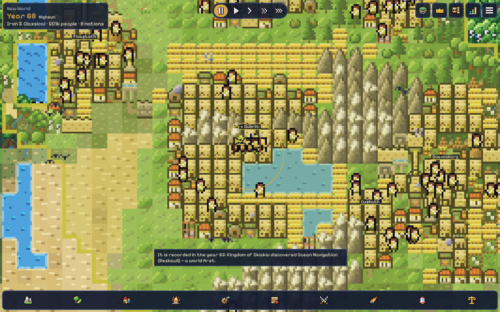 |  |

### Zoom into a city

Zoom in and each district of a city opens into a proper block, drawn from what is really there:
- streets with sidewalks (dirt lanes and cobbles in older eras);
- houses with yards, row houses, apartments and towers;
- shops, cafés, gyms, clinics, schools with sports fields, car parks, parks and factory yards;
- people walking the sidewalks and traffic of the era in the lanes.

Zoom in further and the map shows its inhabitants the way WorldBox does: people, animals and vehicles keep a small, readable size while the city grows around them.
- In small towns you see the **real residents**: rulers, generals, priests, children and workers, each drawn by role, age and job. Tap one to open their life story.
- Big cities show their famous people (marked with a star) and a crowd drawn from the jobs the city really has.
- Herds spread out, wandering bands show their members, chimneys smoke and flags fly over palaces, temples and universities.
- Press **Follow** in a panel to keep the camera on a person, army, herd, town or nation, and **★** to add it to your favourites in the game menu.

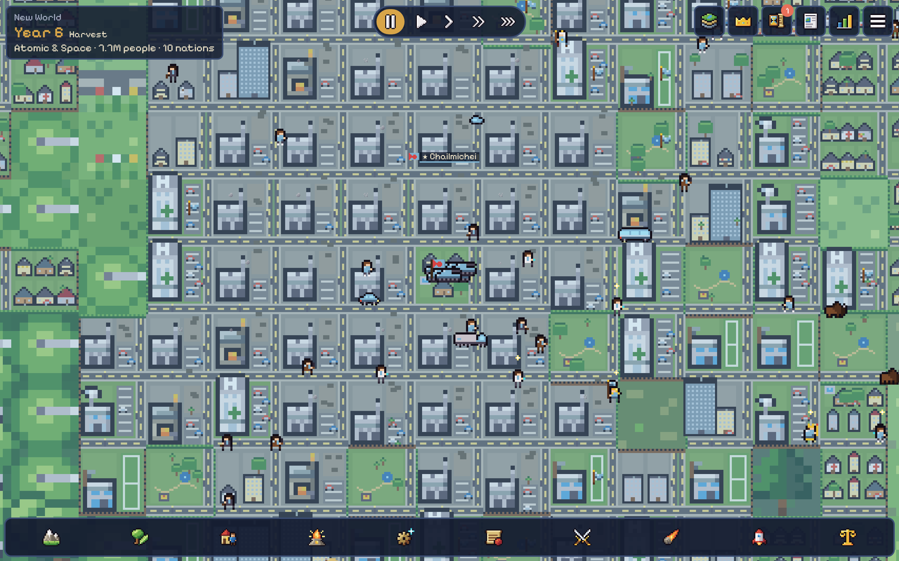

Older towns grow organically, and industrial cities follow a grid. Cities also keep their breathing room: new homes, shops and civic buildings must stay next to open land, and large cities plant parks.

Cities follow real-world rates:
- **Streets and parks.** Street space grows from about a tenth of a block in early towns to nearly a third in modern cities. Parks follow each era's share of city land: cities short of green space set aside one district in every few they develop.
- **Traffic.** Each city's vehicle trips are counted against its street capacity, from carts to cars to shared autonomous pods. Busier cities show more vehicles.
- **Homes.** Past huts and caves, homes come in many forms: cottages, longhouses, villas, terraces, tenements, manors, detached houses, duplexes, mid-rise and high-rise flats, mansions, eco-pods and sky villas. The mix depends on the era, the district and how rich and unequal the nation is.
- **Roads.** Paved roads and highways run through the blocks as arterials and divided highways.
- **Rebuilding.** Old districts are renovated, built up denser or redeveloped for new uses.
- **Jobs.** Each city lists what its people do for a living (gatherers, farmers, smiths, factory workers, programmers, AI supervisors and more). A chart shows how the nation's work changes as its technology changes.

| A modern capital | A medieval town |
|---|---|
|  | 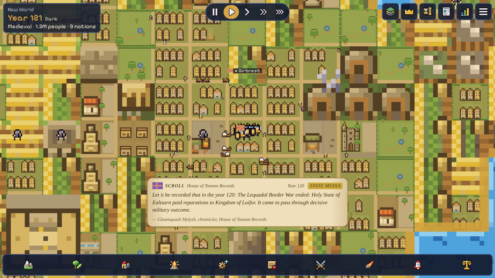 |

### News in the medium of its time

Every nation has a news feed, and its whole look follows what that nation has invented. It starts as a painted cave wall and moves through clay tablets, a scriptorium with quill and town crier, a printing house, a newspaper front page and a broadcast studio, to a social app with generated platforms, trending topics and people to follow, and finally a holographic feed. The whole panel becomes that medium, with its own colours and lettering: carved pixels, inscribed capitals, medieval calligraphy, the types of an early printing house, a blackletter masthead, TV captions and a futuristic face. Posts scroll as one list. Every post retells something that really happened in that world. The authors are real outlets, people and AIs of that nation, and replies take their mood from the nation's measured war weariness, unrest, polarization and misinformation. Platform names, AI systems, hashtags and handles are newly generated in every world.

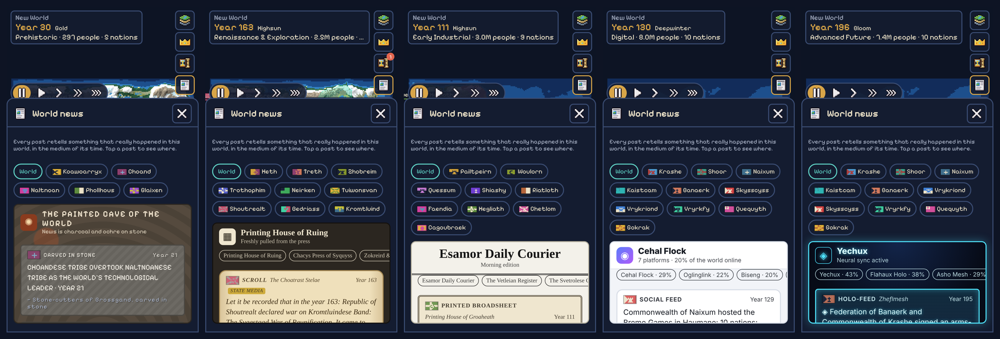

### Pictures of every city, and an album through the centuries

Tap a nation to see its key figures (people, years alive, era, output, military, contacts; each opens its detail tab) and **live pictures of its cities**. The aerial view is drawn from the real map, with every road and building where it stands, styled by era: an ink survey map, then black-and-white film, colour film and satellite images. The street-level postcard shows the real skyline, buildings in the style of the era they were built in, the sea or river where the city meets the water, and the traffic of the day. Every 50 years a postcard goes into the nation's **album**. Both can be saved as PNG files.

| Nation overview with live city pictures (a donut-shaped world) | The 50-year album |
|---|---|
| 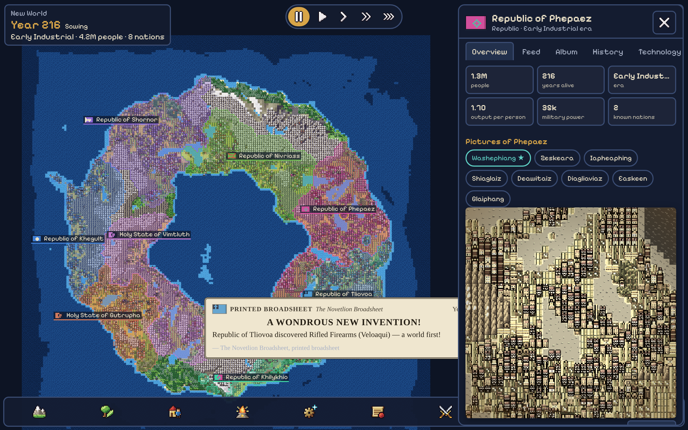 | 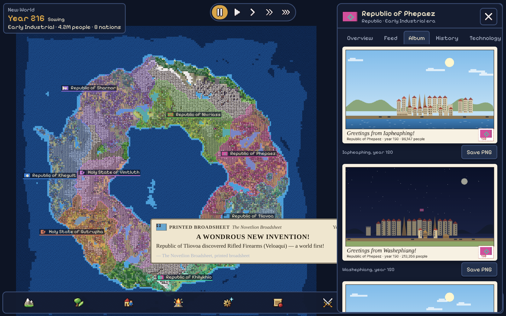 |

| Aerial photo | Postcard |
|---|---|
| 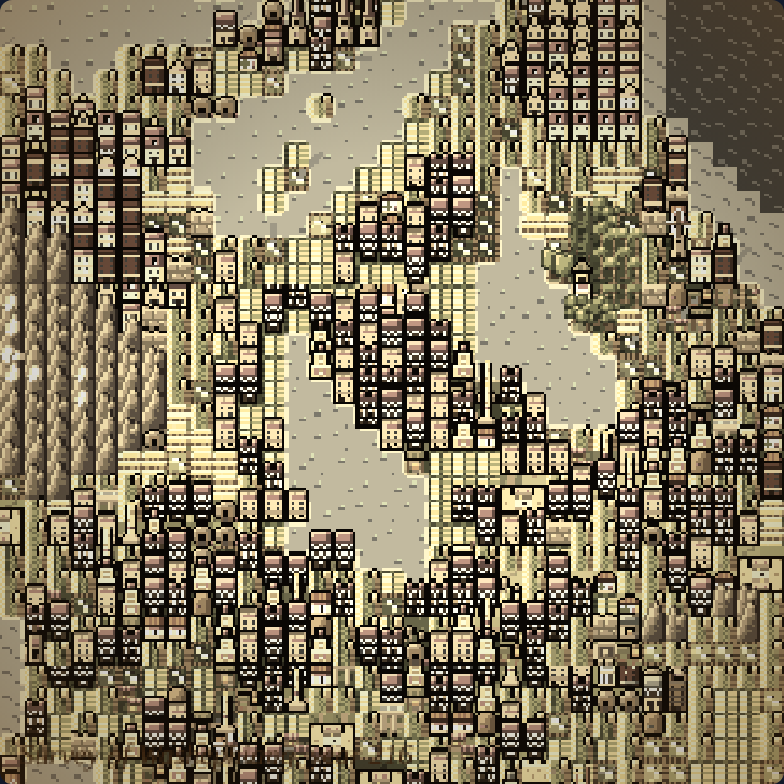 | 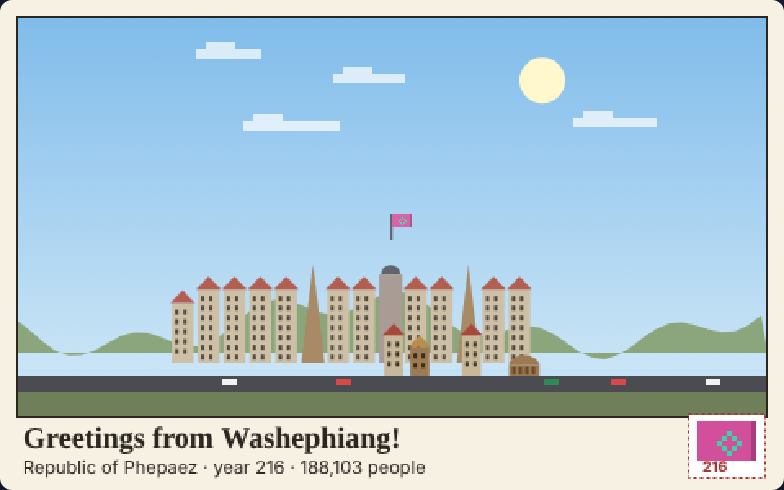 |

### 17 map shapes

Natural continents, or a world shaped like a circle, square, donut, crescent, spiral, shards, checkerboard or mirror image. There are also highlands, deserts, a waterworld, a frozen world, a pangaea, twin continents, many continents and a rift. Rivers, climate and settlement all follow the shape.


### Nations that differ, and ways they end

- **Values (ethos).** Each nation develops one of 11 value systems: technocratic, theocratic, militarist, mercantile, egalitarian, ecological, isolationist, expansionist, traditionalist, artistic, or *atomic-age retro-futurist* (chrome and nuclear power everywhere, slow to go digital). Its values steer what it researches, builds, taxes and permits.
- **Missions.** National goals emerge from conditions, each with a measured target and a deadline: an age of discovery, a frontier push, a great awakening, a merchant empire, iron legions, a golden age, a race to the stars, a green renewal, bread and health, a shield of the realm, a great leap of industry. In god mode you can decree one.
- **Sports and visitors.** Leagues in the sports of each era, international cups and world games with host bids, medal tables and boycotts. Stadiums show the sport the city's team plays. Ports and airports open visitor and trade accords.
- **Transport by era:** porters, carts, horses and buggies, trains and trams, cars and buses, aircraft, flying cars and hoverboards.
- **War and endings.** Weapons and doctrines by era, nuclear arsenals and deterrence, and arms control. Realistic endings come at rates based on real-world frequencies: conquest, civil war, famine, pandemics, engineered pandemics, nuclear war and nuclear winter, asteroid impacts, supervolcanoes, AI takeover, grey goo and more, each recorded with its causes. God mode adds zombies, ghouls and blight, which can never appear in Realistic worlds.

All buildings, people, vehicles and stadiums are pixel art generated by code ([contact sheet](docs/images/sprites/contact-sheet.png)).

### Nations with flags, rulers and people with life stories

Every nation gets its own generated flag, government, culture, language and religion. Rulers and notable people grow skills, earn traits from what happens to them (a *veteran* after battles, *beloved* after a just reign, *scarred* after a defeat) and keep a dated life story.

| Nations and flags | A nation | A ruler's biography |
|---|---|---|
| 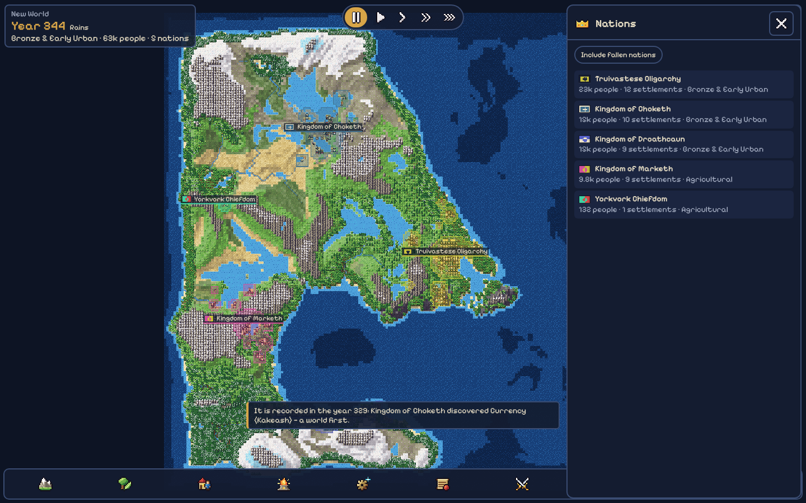 |  | 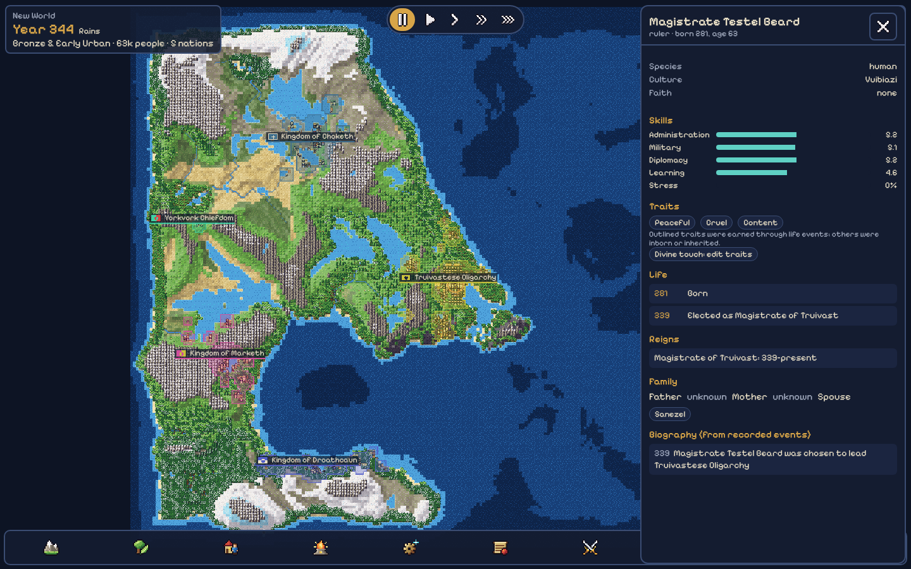 |

### See the world in 16 map layers

Nations, population, technology, religion, culture, language, resources, economy, trade, military, diplomacy, pollution, climate and infrastructure. There is also **Past borders**, which has a year slider so you can scrub back through history.

| Religions | Past borders (with a year slider) |
|---|---|
|  | 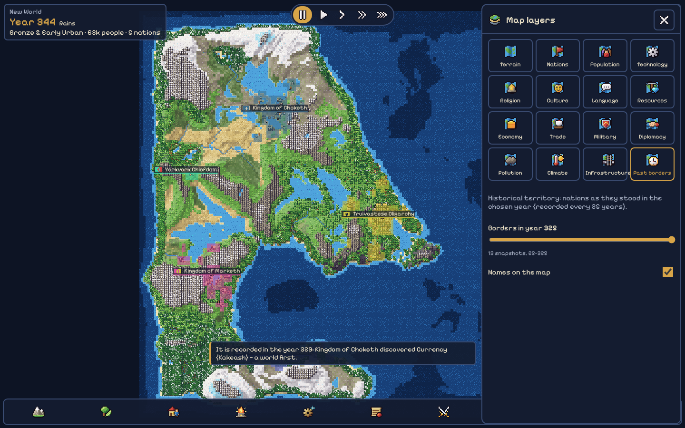 |

### Read the history and the numbers

Every event is recorded with its causes. Charts show population, economy, technology and more, and every number is calculated from the simulation, never invented.

| History | Statistics |
|---|---|
|  |  |

### Play god, or just watch

**123 god powers** come in 9 groups: shape land, plant forests, place peoples and 24 kinds of animal, found faiths, grant knowledge, start or end wars, call down disasters and launch the space age. You can also change the **world laws** and edit any person's traits ("divine touch"). Every power and every major event shows its effect where it happens (a quake ring, a meteor that falls and explodes, fireworks for world games), as a still marker if Reduce motion is on.

Three ways to play:
- **God mode** (every preset except the two below): every power.
- **Realistic:** an empty Earth-like world at year 0, with land, plants and wild animals. You drop in the first humans and any of 24 real animals (elephants, water buffalo, llamas and seals among them) with a pixel hand, as in WorldBox. Everything else happens on its own:
  - natural disasters at natural rates;
  - every science-based technology, era 15 included (AI, holograms, future weapons);
  - wars, nuclear weapons, pandemics, AI takeover and the rest of the realistic endings.

  Nothing fictional can ever appear: no monsters, ghosts, zombies, fantasy peoples or alien land. Land tools and disasters are god-mode powers. People and animals breed where they could really live, and leave harsh land if they can (life audit in [VALIDATION.md](docs/VALIDATION.md) §R10).

  The pace is **Slow**: people take generations to settle and centuries to build cities. On five test worlds, a placed band founded its first village in years 58–147 and the first city of 10,000 stood in years 829–1,056 (calibration in [VALIDATION.md](docs/VALIDATION.md) §R10).
- **Observer:** history runs entirely on its own, with no powers. Natural disasters and epidemics still happen, and nothing fictional can appear.

The Pace setting (Standard or Slow) is also on the New World screen for any world.

| God powers | Observer mode |
|---|---|
|  | 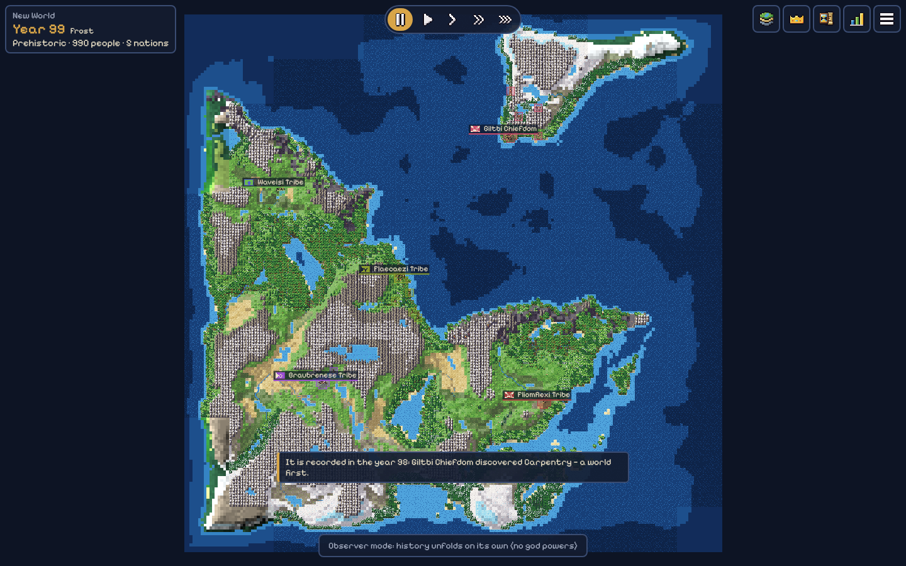 |

### Save, load, branch and share

Your worlds are saved in your browser, with autosave. You can export a world as a `.epoch` file to back it up or share it, and **branch** a world to explore an alternative timeline. A loaded save continues *exactly* the same history.

Every save remembers **which device made it** (for example "iPhone · Safari"; rename yours in Settings). The Load screen lists worlds started on this device first, then those that came from your other devices, and says where each world has been saved. A device here means a browser: nothing is uploaded, and the label is just a random id kept in that browser.

---

## Play on iPhone

> These screenshots come from the game running in a phone-sized browser window. On a real iPhone it looks the same.

### Option A: Open the web link (easiest)

1. Open **Safari** on your iPhone.
2. Go to the game's address. If you use this repository's GitHub Pages, that's
   **`https://jviola1019.github.io/worldsim/`**. Pages must be switched on once first: see [Publish your own copy online](#publish-your-own-copy-online-github-pages).
3. Tap **New world**, then **Create world**.
4. Tap the **fastest play button** (▸▸▸) at the top and watch history unfold.

| ① Title screen | ② Choose a starting point | ③ Your world, explained |
|---|---|---|
| 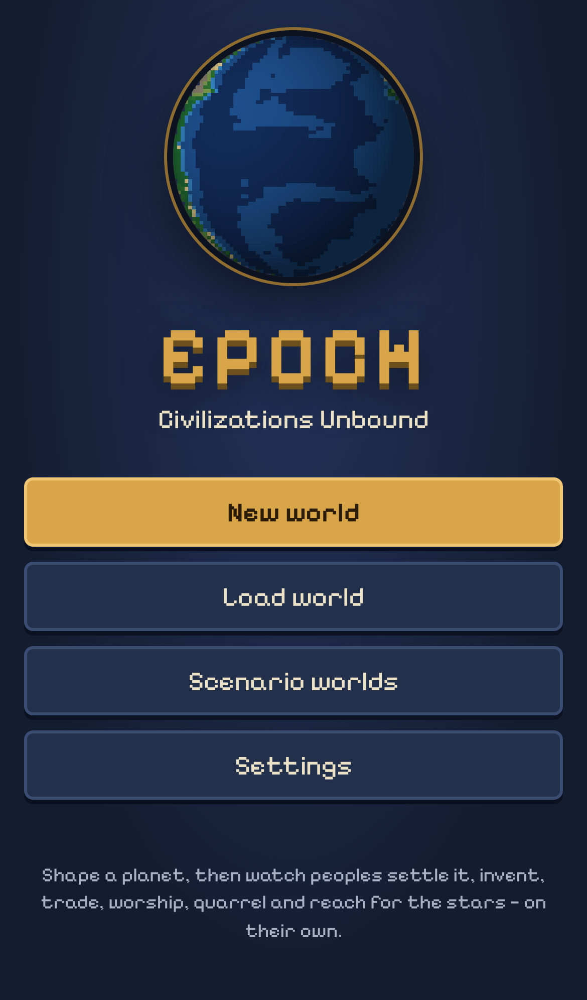 | 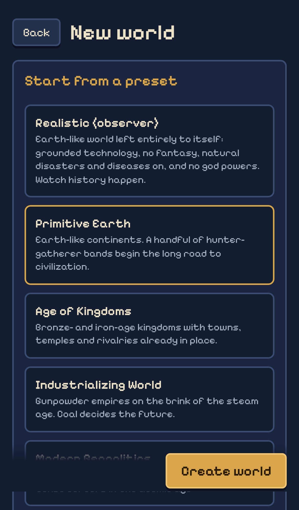 |  |

**Make it feel like an app:** in Safari, tap the **Share** button (the square with an arrow), scroll down, tap **Add to Home Screen**, then tap **Add**. An EPOCH icon appears on your home screen and the game opens full screen.

### Option B: From your own computer over home Wi-Fi (no internet publishing)

1. Set up the game on your PC or Mac first (see [Option B below](#option-b-run-it-on-your-own-computer)).
2. In the terminal, type `npm run dev:lan` and press Enter.
3. The terminal shows a line like `Network: http://192.168.1.23:5173/`.
4. On your iPhone, connected to the **same Wi-Fi**, type that address into Safari.

---

## Play on a PC or Mac

### Option A: Open the web link

Open the game's address in **Chrome, Edge, Firefox or Safari**, then click **New world → Create world**.

**Install it like an app (Chrome or Edge):** click the small *Install* icon at the right end of the address bar (a monitor with a down arrow), then click **Install**. EPOCH gets its own window and a desktop icon.

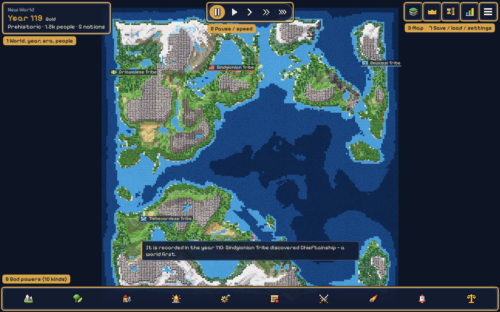

### Option B: Run it on your own computer

Use this if there's no web link, or if you want to play offline. It takes about five minutes the first time.

1. **Install Node.js.** Go to **nodejs.org**, download the **LTS** version, and run the installer, clicking *Next* through it.
2. **Download the game.** On the GitHub page, click the green **Code** button, then **Download ZIP**. Unzip it, for example on your Desktop.
3. **Open a terminal in that folder.**
   - **Windows:** open the unzipped folder, right-click an empty space, and choose **Open in Terminal**.
   - **Mac:** open **Terminal**, type `cd ` (with a space), drag the folder into the window, and press Enter.
4. **Type these two commands**, pressing Enter after each:
   ```bash
   npm install
   npm run dev
   ```
5. **Open the game.** Open your browser and go to **http://localhost:5173**.

To stop the game, click the terminal and press **Ctrl + C**. Next time, only steps 3, 4 (`npm run dev` only) and 5 are needed.

| ① Title screen | ② New world |
|---|---|
| 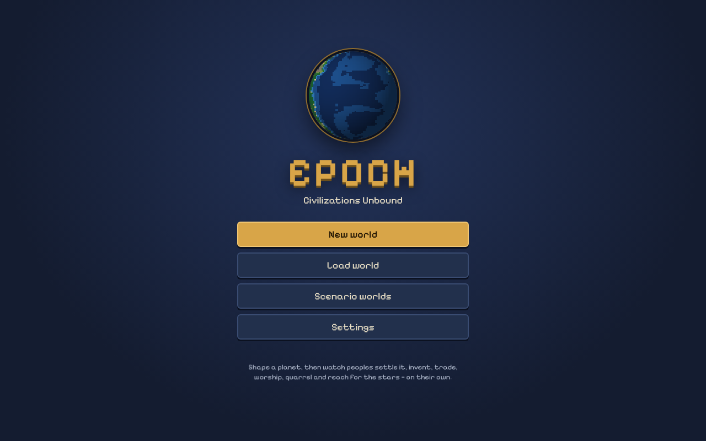 |  |

---

## Publish your own copy online (GitHub Pages)

This repository includes an automatic publishing workflow (`.github/workflows/pages.yml`). Every time the default branch or `main` changes, it tests the game, builds it and publishes the built game (not the source files).

**One-time setup, about 2 minutes:**

1. On GitHub, open the repository and click **Settings**.
2. In the left menu, click **Pages**.
3. Under **Build and deployment → Source**, choose **GitHub Actions**.
4. Click the **Actions** tab, then **Deploy to GitHub Pages** in the left list, then **Run workflow** (or merge your work into `main`).
5. When it finishes (green tick), the link appears on the workflow page and under **Settings → Pages**:
   `https://<your-username>.github.io/<repository-name>/`.

> **Notes**
> - GitHub Pages on a *private* repository needs a paid GitHub plan. Public repositories are free.
> - By default, GitHub only publishes from the main branch. To publish from another branch, either merge into `main` or allow that branch under **Settings → Environments → github-pages**.
> - The published game makes no network calls; saves stay on each player's device. The pixel font is bundled with the game, and the build carries a strict Content-Security-Policy ([SECURITY.md](docs/SECURITY.md)).

---

## Controls

| | Touch (iPhone/iPad) | Mouse and keyboard (PC) |
|---|---|---|
| Move the map | Drag with one finger | Drag; or right or middle button; or hold **Space** and drag |
| Zoom | Pinch with two fingers | Mouse wheel, or the **+** and **−** keys |
| Inspect a town, nation, army or animal | Tap it (press and hold for details) | Click it |
| Use a god power | Pick it in the bottom dock, then tap or paint | Same, with the mouse |
| Move the map while painting | Use **two fingers** (they always move the map, never paint) | Right or middle button |
| Undo a terrain edit | **Undo** in the dock | Same |
| Speed | Buttons at the top: pause, 1× to max | Same |

The numbered pictures above ([iPhone](docs/images/guide-iphone.png), [desktop](docs/images/guide-desktop.png)) label every button on screen.

---

## Is it really realistic?

The simulation is a game, but it is built to be **internally consistent** and **checked against itself**:

- **Natural history with no player at all.** Four 1,000-year runs with zero god powers on a 128² map (three default worlds and one hands-off world, now the Observer preset) all went from foragers to farming (years 160–182), the Middle Ages (398–420) and industry (538–599), then to the modern era (662–783) and the atomic and space age (703–892). Three reached the Digital era (763–786). Two default worlds became Spacefaring (973 and 988), and the hands-off world reached the Near Future in year 831. Each run also had 22–41 notable natural disasters, 184–645 deadly epidemics, droughts, and 3–10 °C of emergent warming. The 10 °C case is a known limitation ([STATUS.md](docs/STATUS.md)). Raw output: [`docs/data/round5/`](docs/data/round5/); method: [`scripts/modernization.ts`](scripts/modernization.ts).
- **Nations rise and fall for recorded reasons.** In 10 worlds × 600 years, 77 nations were founded and 13 fell (5 conquests, 5 civil wars, 2 famines, 1 dispersal). Rare catastrophes stay rare: no nuclear use, 8 large eruptions and 8 airbursts across those 6,000 world-years ([`scripts/endings-census.ts`](scripts/endings-census.ts)).
- **People are never created or lost by accident.** A population ledger accounts for every birth, death, migration, conquest and rounding, exactly, at every moment of the simulation.
- **The economy adds up.** GDP equals consumption + investment + government + net exports + inventory change, in every nation and every year.
- **Saves reproduce the future.** A world saved and reloaded continues the identical history for decades, which is checked automatically.
- **Hostile save files are refused safely.** Malformed or oversized imports are rejected without touching your saved worlds. All 92 threats in a public-use security checklist were reviewed ([SECURITY.md](docs/SECURITY.md)).
- **Cause and effect are tested** with twin worlds that differ in one thing only. Examples: a drought raises food prices; an embargo hurts the nation that depended on it; schooling raises research; electricity enables power plants.

What is still simplified or limited is listed openly in [docs/STATUS.md](docs/STATUS.md). The main open items: modern unemployment stays high (15–36% in the long runs), some worlds warm by 7–10 °C, and nothing has been tested on a physical phone.

---

## For developers

**New to the code?** Read [docs/GUIDE.md](docs/GUIDE.md), a guided tour of the whole code base with diagrams. Or open the [interactive code guide](https://jviola1019.github.io/worldsim/guide/): a clickable map of the code, the simulation's timeline, measured balance charts, and a search over every file.

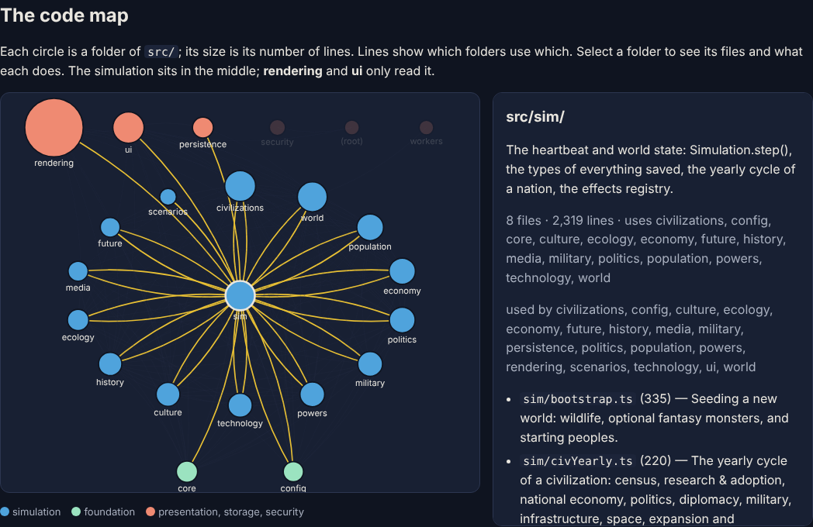

TypeScript 7, Vite 8, Preact 11, Canvas2D, Vitest 5. Runtime dependencies: Preact and the bundled Pixelify Sans font.

| Command | What it does |
|---|---|
| `npm install` | Install dependencies |
| `npm run dev` / `npm run dev:lan` | Dev server on localhost / also on your LAN (for phones) |
| `npm run build` | Type-check and build the static site into `dist/` |
| `npm run preview` / `npm run preview:lan` | Serve the built site on port 4173 |
| `npm test` | 623 unit, integration, counterfactual, round-trip, map-preset and security tests (about 2 minutes) |
| `npm run e2e` | Browser test on the production build (iPhone 13 emulation and desktop), 74 checks; `BROWSER=webkit npm run e2e` runs them on WebKit (Safari's engine) on phone, desktop and Reduce motion, including the close-up city, people up close, follow and favourites, saves by device, jobs, map effects, the code guide, feed, city pictures, album, CSP and framing; needs `npm run preview` running |
| `node tools/viewports.mjs` | Layout check on 6 device sizes, failing on text under 12 px, touch targets under 44 px or contrast below WCAG AA |
| `node tools/design-capture.mjs` | Design-review captures of every screen on 5 devices, with measurements |
| `node tools/perf-closeup.mjs` | Close-up frame times (CPU throttled ×4) |
| `npm run stats -- 20 600 96` | 20-seed statistics with invariant checks |
| `npx tsx scripts/modernization.ts <seed> 1000 128 [realistic]` | Natural-history run: era timeline, modernization indicators, natural hazards |
| `npm run bench -- 128 900` | Simulation speed per simulated year |
| `npx tsx scripts/endings-census.ts` | How nations end, and how often catastrophes strike, over many worlds |
| `node tools/gallery.mjs`, `node tools/gallery-r5.mjs`, `node tools/guide.mjs` | Regenerate the README screenshots |
| `npm run sprites:sheet` | Regenerate the sprite contact sheet |

**Continuous integration:** `.github/workflows/ci.yml` runs typecheck, tests, build and the browser test (Chromium, then WebKit) on every push. `long-run.yml` runs weekly long simulations, and `pages.yml` publishes the game.

### Documentation

| Document | Contents |
|---|---|
| [STATUS.md](docs/STATUS.md) | What is complete, partial, experimental or missing; bug ledger; ranked next steps |
| [METHODS.md](docs/METHODS.md) | How every number is produced: the reproducibility contract, experiment designs, decision rules, statistical limits, known modelling gaps |
| [PARAMETERS.md](docs/PARAMETERS.md) | Every model coefficient with its value and evidence class (generated from the code) |
| [VALIDATION.md](docs/VALIDATION.md) | How everything was verified: tests, seeds, twin-world experiments, long runs, browsers |
| [ARCHITECTURE.md](docs/ARCHITECTURE.md) | Modules, tick model, ERD and data dictionary, yearly pipeline, determinism rules, population ledger, saves |
| [ROADMAP.md](docs/ROADMAP.md) | Round-5 decisions and phase status |
| [MODEL.md](docs/MODEL.md) | Every simulation assumption, labelled evidence-informed, stylized or speculative |
| [PERFORMANCE.md](docs/PERFORMANCE.md) | Measured speed and memory, with how to reproduce them |
| [DESIGN-REVIEW.md](docs/DESIGN-REVIEW.md) | Round-6 design review: 13 findings, fixes, before/after measurements |
| [SECURITY.md](docs/SECURITY.md) | 92-threat security matrix with evidence, fixes, items for the owner to verify, and a threat model for a future backend |
| [FEATURES.md](docs/FEATURES.md) | Comparison with the genre reference (WorldBox) |
| [ASSETS.md](docs/ASSETS.md) | Every sprite family: all art is generated by code in this repository |
| [REQUIREMENTS.md](docs/REQUIREMENTS.md) | The numbered requirements (R0–R17) |

**Original work.** The genre reference is WorldBox; no code, art, names or layouts were copied. All pixel art is generated by code in this repository.

**License:** MIT.
