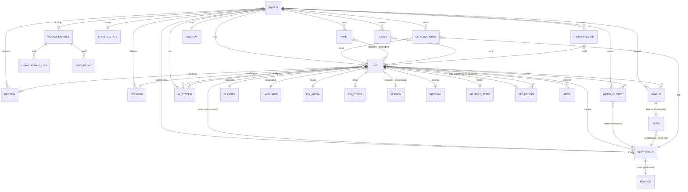

# Architecture

TypeScript 7.0, built with Vite 8. The UI is Preact 11 (about 4 KB), rendering uses Canvas2D, and Vitest 5 runs the tests.
The only other runtime package is the self-hosted Pixelify Sans font (`@fontsource/pixelify-sans`, OFL-1.1).
The app is a static site with no server and no network calls (see [SECURITY.md](SECURITY.md)).

## Module map (`src/`)

| Module | Responsibility |
|---|---|
| `core/` | Seeded RNG (sfc32, with state kept in the world), simplex noise, hashing and digest, math helpers, binary heap, calendar. |
| `config/` | World laws, `BALANCE` constants, world-size presets, scenario presets, engine and save versions. |
| `world/` | Terrain enum, `TileMap` (typed arrays per field), world generation (plates, rain shadow, hydrology, biomes, deposits), **map presets** (`mapShapes.ts`: 16 shapes and extremes plus natural), A* pathfinding, environment (fire, disasters, regional climate AR(1), CO₂ forcing, sea level), **natural catastrophes** (`catastrophes.ts`: airbursts, impacts, VEI-7/8, geomagnetic storms, superflares, gamma-ray bursts). |
| `sim/` | `WorldState` types, world creation, the `Simulation` orchestrator, the per-civilization yearly cycle, bootstrap (later-era starts, collapse scenario), maintenance. |
| `population/` | Individuals (`persons.ts`), traits, **character development** (`development.ts`), demography (age cohorts, mortality and fertility schedules), bands, agents, migration, SIR disease, and the **population ledger** (`ledger.ts`). |
| `civilizations/` | Settlements (monthly cycle), building types, urban planning and construction (redevelopment, construction reserve, material substitution), territory, civilization identity, knowledge and contact. **Ethos** (`ethos.ts`, 11 value archetypes scored relative to other nations), **missions** (`missions.ts`, emergent national goals with metric, target and deadline; god-mode decrees), **endings** (`endings.ts`, typed collapse with causes, global cooling). |
| `economy/` | Production per settlement (industrial extraction, automation, working hours), the national market and public finance (`market.ts`), trade, routes and infrastructure, **visitor accords** (`visitors.ts`). |
| `technology/` | 207-tech dependency graph, research with discovery kept separate from adoption, capability aggregation, forgetting, **technological overtaking** (`overtaking.ts`: leapfrogging, sclerosis, tech-lead history). |
| `politics/` | Institutions, factions, elections, coups and revolutions, secession; succession, dynasties and notables; diplomacy, treaties and organizations. |
| `military/` | Armies, A* movement, Lanchester battles (linear before gunpowder, square after), sieges, supply. **Weapons and doctrines by era** (`weapons.ts`), **nuclear arsenals, doctrine, deterrence, fallout and nuclear winter** (`nuclear.ts`). |
| `culture/` | Languages (phonology, drift), religions (emergence, doctrines, schism), culture traits and blending, **infinite unique names** (`naming.ts`: outlets, platforms, AIs, labs, hashtags, handles, nations, religions; blocked real brands), **sports** (`sports.ts`: 11 era sports, leagues, cups, world games). |
| `ecology/` | Species, herds, predation, domestication, subspecies divergence, monsters (fantasy toggle). |
| `future/` | Space programs, colonies, **anthropogenic risks** (`risks.ts`: engineered pandemics, AI takeover, grey goo, lethal heat). |
| `history/` | Event log with causes, newspaper text, sampled statistics, historical territory snapshots, **era-medium feed** (`feed.ts`, `feedFrame.ts`: posts and app frames from cave wall to holonet), **city album** (`album.ts`: compact postcard layout records every 50 years). |
| `media/` | **Media and AI simulation** (`media.ts`: outlets by era with life cycles, reach, trust, state control; polarization, misinformation, online share; AI labs with versions, capability, alignment, autonomy and incidents), `medium.ts` (a nation's current medium). |
| `security/` | Browser security policy (CSP and headers, `policy.ts`) and the cross-origin frame check (`framing.ts`). |
| `persistence/` | Binary save format, IndexedDB slots, autosave rotation, export and import, migrations. |
| `powers/` | God-power definitions (97 tools in 10 categories), undo stack, **god-mode horrors** (`horrors.ts`: zombies, ghouls, blight; refused in observer worlds). |
| `rendering/` (round 6) | **Close-up cities.** `cityBlocks.ts` is pure: one tile's real data becomes a 32×32 block plan (streets by era, plots with open ground, yards, amenities by size band and ethos, civic grounds). `cityLayer.ts` caches 8×8-tile detail chunks (LRU 48, invalidated by the map's dirty flags plus a yearly signature check) and draws them over the map from 20–26 px per tile; under it sits a base map without the city buildings. `art/city_lots.ts` holds 117 generated lot sprites. The aerial photo uses the same drawing. |
| `rendering/` | Procedural pixel-art atlas (708 sprites, plus the round-5 pack: housing styles, sports venues, ports and airports, era vehicles, characters and jobs; selection rules in `art/select.ts`), camera, chunked terrain layer, overlays (16), renderer, procedural flags, **city photos** (`photos.ts`: aerial view from the real tiles, street-level postcard from layout records). |
| `ui/` | Screens, HUD, tool dock, inspectors, panels, charts, input classification, audio, preferences. |
| `workers/` | World generation in a Web Worker, so the UI never freezes during creation. |

## Time and the tick model

- 1 tick ≈ 3 days, 10 ticks make a month and 120 ticks make a year (`core/time.ts`).
- Per tick: fire and environment, herds, bands, agents, armies, monsters, and one vegetation slice.
- Monthly, staggered: settlement `s` runs on tick slot `s.id % 10`, which spreads the load.
- Yearly, staggered: civilization `c` runs on day `(c.id·37) % 120`. Global yearly systems (stats, trade,
  species census, evolution, religion, culture, climate, notables) run on day 0.
- `Simulation.advance(realMs, ticksPerSecond, budgetMs)` converts real time into ticks under a wall-time budget,
  so input stays responsive. Rendering never drives simulation logic. Frame rate and simulation rate are
  independent; a test checks that frame slicing gives identical results.

## Data model

`WorldState` (`sim/types.ts`) is plain data: a `TileMap` of typed arrays (terrain, elevation, owner, settle,
bld, bldFlags, veg, fert, temp, moist, river, flow, infra, hazard, pollution, fire, dep, and so on) plus
id-keyed `Map`s of civilizations, settlements, persons, dynasties, armies, wars, herds, bands, religions,
cultures, languages, diseases and relations. It also holds the event log, statistics, climate, laws and RNG state.

A tile represents about 100 km² (8×8 art pixels). Buildings are *districts*: non-agricultural job counts are
scaled ×10. A settlement keeps individuals while it has fewer than 150 people and switches to 17 age-band cohorts
above that, with hysteresis back to individuals below 60. Notable persons (rulers, heirs, generals, founders,
prophets) are always individuals and are kept after death for history and biographies.

### Entity-relationship diagram

All entities live in `WorldState` as id-keyed `Map`s, or as arrays for records. References are by numeric id. Cardinalities are as enforced by the simulation; ids are never reused.

### Data dictionary (round 4 and 5 entities)

Every field marked *optional* is absent from older saves. The defensive decoder defaults it, or the system creates it on first use, so old saves load.

| Entity | Key fields | Bounds and validation on load | Written by | Read by |
|---|---|---|---|---|
| `MediaOutlet` (`w.outlets`) | `id`, `civId`, `kind` (chronicle → holonet), `name` (generated, unique), `founded`/`closed`, `settlementId`, `reach` 0..1, `trust` 0..1, `stateRun`, `moderation` | Entity list check (`id` int ≥ 1); id counter defaulted | `media/media.ts` | feed, feed frames, inspector, digest |
| `AISystem` (`w.ais`) | `id`, `civId`, `name`, `lab`, `version`, `role`, `status`, `capability`, `alignment`, `autonomy`, `incidents` | As above | `media/media.ts`, `future/risks.ts` | feed, risks (AI takeover), inspector |
| `CivMedia` (`civ.media`, optional) | `polarization`, `misinformation`, `trust`, `freedom`, `online`, `aiResearch`/`aiGovernance`/`aiDefense`, `lastIncident` | Created on first use | `media/media.ts` | politics (unrest, corruption), production (services), stats |
| `CivEthos` (`civ.ethos`, optional) | `key` (11 archetypes), `since`, `strength` | Created on first use | `civilizations/ethos.ts` (yearly, with hysteresis) | research, adoption, building priorities, budget, policies, personality, drift, housing style |
| `Mission` (`civ.mission`, optional) + `missionLog` | `kind`, `since`, `until`, `start`, `target`, `reason`, `assigned` | Created on first use | `civilizations/missions.ts` (emergent; god decree) | research and build multipliers, legitimacy, overview |
| `Arsenal` / `MilitaryState` (optional) | doctrine, progress, launched; land doctrine, weapons, arms race, multipliers | Created on first use | `military/nuclear.ts`, `military/weapons.ts` | war utility, battles, deterrence |
| `CivEnding` (`civ.ending`, optional) | `type` (27 kinds), `year` (= `civ.fell`), `causes[]`, `by` | — | `civilizations/endings.ts`, `killCiv` | history, inspector, endings census |
| `League` (`w.leagues`) + embedded `Team[]` | `sport` (11), `name`, `founded`, `teams` (name, home `settlementId`, rating, titles), `champions[]`, `active` | Entity list check; id counter defaulted | `culture/sports.ts` | terrain layer (arena venue per sport), overview |
| `SportsState` (`w.sports`, optional) | `next` games year, `held[]` (host, medals, boycotts), `cups[]` | Arrays and finite `next` checked, else dropped | `culture/sports.ts` | prestige, relations, feed |
| `CitySnapshot` (`w.album`, optional) | `year`, `civId`, `sid`, names, `pop`, `era`, `tier`, `color`, `emblem`, `ethos`, `cols` (base64 column records) | ≤ 5000 entries, `cols` ≤ 4096 chars, `n` ≤ 256, `#rrggbb` colour; capped at 600 in play | `history/album.ts` (every 50 years) | `rendering/photos.ts` (postcards), Album tab |
| `WorldEndings` (`w.endings`, optional) | tech lead and history, `chemBan`, `lastNuclearUse`, `coolingSource`, `uv`, `log[]`, `cure{}`, `goo[]` | History ≤ 2000, log ≤ 1000 with type strings ≤ 40, cure in 0..1 (≤ 10,000 keys), goo ≤ 100 with radius < map side, finite numbers | endings, catastrophes, nuclear, risks, horrors, overtaking | climate (cooling), yields, feed, tech-lead UI |
| `Horror` (`settlement.horror`, optional) | `kind` (zombie, ghoul, blight), `level`, `since` | Removed every year in observer worlds | `powers/horrors.ts` | settlement mortality (ledger: disease), map |
| `Treaty` kinds (round 4/5) | `visitors` (visitor accord), `arms_control` | — | `economy/visitors.ts`, `military/nuclear.ts` | diplomacy, war utility |

Derived, never stored: feed posts and frames (hashed from event ids), photos (rendered from tiles and records), sprite choices (pure functions in `art/select.ts`). They cannot change the simulation, and tests compare digests to confirm it.

### Planning rule (round 6)

`civilizations/urban.ts` applies a rule when it picks sites. A new home, shop or civic building must leave itself and every built 4-neighbour touching open land: unbuilt land, water, a park, fields or the map edge (`isOpenTile`, `keepsAccess`).

- Industry and energy are exempt.
- A housing crisis (pressure > 1.5) may fill enclosed gaps.
- Upgrades in place are never blocked.
- Cities above 2,000 people aim for one park per 8 residential districts.
- Settings: `BALANCE.streetAccess`, `parkPerResidential`, `parkMinPop`, `urbanAdjBonus`, `enclosedPenalty`, `infillPressure`.

The rule adds no saved state.

### Yearly pipeline

Per civilization, staggered across the year on day `(id·37) % 120` (`sim/civYearly.ts`): ethos → missions → research → economy → politics → diplomacy → military → infrastructure → space → media → risks → sclerosis → absorption → domestication. A nation that dies part-way stops there.
World, on day 0 (`sim/simulation.ts`): statistics → trade → species census → evolution → religion → culture → sports → visitors → album → climate → catastrophes → world risks → horrors → tech lead → notables.

## Determinism rules

1. All randomness comes from `sim.rng`, whose state is in `w.rng` and is synced before saving.
2. `sim.cache` holds **derived data only**. Anything that affects a later result must either live in
   `WorldState`, so it is serialized, or be recomputable from current state within the same tick.
   Writing the round-trip test enforced this and found seven violations, each fixed:
   - The yearly site survey moved to `Settlement.sites`.
   - Last year's stock value and money supply moved to `Civ.prevStockValue` and `Civ.prevMoney`.
   - Trade totals moved to `Civ.tradeExp` and `Civ.tradeImp`.
   - Planned road routes moved to `Settlement.routes`.
   - Building-tile lists and live population are now memoized per tick.
   - Fire iteration is index-ordered.
3. Tick-scoped memos (`bldTiles`, `ownTiles`, `livePop`) are rebuilt from current state within a tick and invalidated on every change to the data they mirror. This is checked by bit-identical digests before and after the memo was introduced.
4. The tests check that the same seed and config give identical digests after 60 years. A save at an arbitrary
   tick, mid-month and mid-year, followed by a load gives the same digest every year for the next 40 years,
   including in an industrial-era world (`tests/persistence/roundtrip.test.ts`).

## Population accounting

`population/ledger.ts` keeps cumulative ledgers that are never reset, one for each civilization and one for the world. Every population mutation is recorded under exactly one key:

- births;
- deaths by cause;
- cross-civ emigration and immigration;
- territorial transfer in and out;
- people lost when settlements are destroyed or abandoned;
- people lost in transit;
- cohort↔individual rounding (`resolution`);
- divine intervention.

The boundary of a civilization is its settlements' residents, its band members, its people in transit (agents) and its colonies. Moves inside a boundary are not recorded at that boundary. Because the ledgers are cumulative, statistics store them as series, so any two samples reconcile exactly even after decimation (`explainPopulationChange`).

## Rendering

The renderer is Canvas2D, chosen because a static pixel-art map with chunk caches needs no GPU pipeline and
Safari support is universal. Terrain is drawn into 16×16-tile chunk canvases (LRU of 220, with a 24 px overhang for
mountains and trees). Below 2.6 px per tile it switches to a single overview image. Overlays render into a
4-px-per-tile canvas. Units, vehicles and buildings are tinted with team colors lazily. Traffic is drawn
from real roads, rails and trade routes, and weather from real rain anomalies. Civilization flags are generated from
`civ.emblem` (eight field divisions × twelve charges) and cached as canvases. The UI uses them as data URLs.

## Persistence

The `EPCH` binary format is a JSON header (meta, ids, entity arrays, a typed-array table) followed by
4-byte-aligned typed-array payloads. It is wrapped in an `EPZ1` frame with a CRC32 and gzip via `CompressionStream`
when available. Saves live in IndexedDB slots with metadata (name, thumbnail, year, seed, engine and format
version, last played) and a rotating autosave. Export and import use `.epoch` files, and branching copies a slot with
lineage. Corrupt frames (CRC mismatch or failed decompression) raise a typed `SaveError` without touching the store.

Decoding is defensive, because imported files are untrusted:
- Gzip output is capped while streaming, at 256 MiB.
- The array table is validated: known keys and types, aligned in-bounds ranges, exact lengths, and arrays located from the header.
- Map size is limited to 1024, and terrain ids, state shape, entity ids, colours, statistics and territory snapshots are validated.
- Every failure is a `SaveError`.
- Saves are atomic: the transaction is aborted on any synchronous `put` failure.
- `open()` never hangs.
- Round-5 fields (album, sports, endings, world name and seed) are bounded and typed.

The production build carries a strict Content-Security-Policy, and the app refuses to run when another origin frames it. See [SECURITY.md](SECURITY.md), which has the 92-threat matrix and the threat model for a future backend.

## Testing

`tests/` holds unit tests (worldgen, tech graph, flags, gesture classification, development) and determinism
and round-trip tests. A stress test runs 300 years and checks bounded growth, the GDP identity and border
consistency. Counterfactual integration tests clone a world exactly, intervene in one copy and compare
(drought, roads, war, legitimacy collapse, cross-border religion, industrial pollution). Every preset is
exercised. `tests/security/` holds the security regression tests and static guards over the source tree and CI workflows. `tests/e2e/run-e2e.mjs` drives the built app in emulated iPhone 13 and desktop Chromium, including CSP and framing checks.
