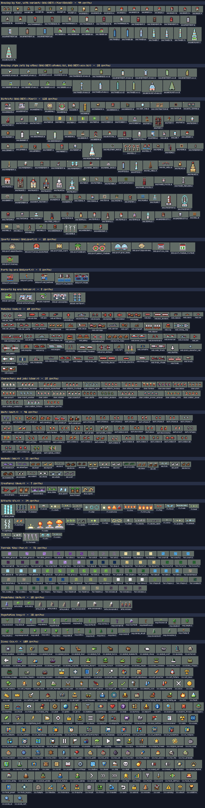

# Asset manifest

Every visual asset is **original and generated from code** in this repository. There are no image files,
downloaded sprites or third-party art. Sprites are text grids of palette letters (see
`src/rendering/art/types.ts`) that are rasterized into an atlas at startup (`src/rendering/atlas.ts`, using the
DOM-free rasterizer in `src/rendering/art/raster.ts`). License: MIT, the same as the code.

All art uses one palette (`src/rendering/art/palette.ts`) at one pixel density: 1 art pixel equals 1 world pixel,
and a tile is 8×8. Scaling is nearest-neighbor only (`image-rendering: pixelated`, smoothing disabled).
Letters `T`, `U` and `V` mark team-color slots, which are tinted per civilization on demand.

## Contact sheet

`npm run sprites:sheet` renders every registered sprite (all frames, labelled, grouped by family) into
[`docs/images/sprites/contact-sheet.png`](images/sprites/contact-sheet.png). Options: `--split` also writes one
PNG per family to `tools/output/`, `--prefix veh.` limits the sheet, `--scale 6` magnifies, and
`--tint '#3a7bd5'` shows team-color slots in a civilization color. It runs in node with no browser (the labels use a
small original bitmap font in `tools/pixel-font.ts`). The older `npm run sprites -- [prefix] [scale]` still writes
unlabelled grids to `tools/output/`.

## Families

| Family (id prefix) | Count | Size (px) | Frames | Source file | Use |
|---|---|---|---|---|---|
| Terrain tiles (`ter.*`) | 72 | 8×8 | 1 | `art/terrain.ts` | 24 terrains with variants and coast/water transitions |
| Mountains (`mtn.*`) | 10 | 8×6 – 8×14 | ≤3 | `art/terrain.ts` | Hills, mountain and volcano overhangs (volcano animated) |
| Vegetation (`veg.*`) | 30 | 5×3 – 8×12 | 1 | `art/vegetation.ts` | Trees per biome, shrubs, crops, cacti, dead trees |
| Units (`unit.*`) | 46 | 7×8 – 14×12 | ≤2 | `art/units.ts` | Citizens per era, soldiers for military tiers 0–12, specialists |
| **Characters (`char.*`)** | 25 | 7×9 – 8×9 | 4 | `art/characters.ts` | Jobs, walkers, soldiers by era, athletes, astronaut, robot (4-frame walk) |
| Animals (`ani.*`) | 22 | 5×3 – 18×14 | ≤2 | `art/animals.ts` | Wild and domesticated species |
| Creatures (`mon.*`) | 7 | 9×10 – 18×14 | ≤2 | `art/animals.ts` | Optional fantasy creatures (fantasy toggle only) |
| Vehicles (`veh.*`) | 69 | 5×5 – 26×17 | ≤4 | `art/vehicles.ts`, **`art/vehicles_era.ts`** | Carts to drone ships; era transport on roads, rails, water and air |
| Effects (`fx.*`) | 34 | 1×2 – 24×24 | ≤6 | `art/effects.ts` | Fire, smoke, clash, construction, weather, explosions, selection, flag |
| Buildings (`bld.*`) | 204 | 8×7 – 16×32 | ≤4 | `art/buildings.ts`, `art/buildings_civic.ts`, **`art/buildings_housing.ts`**, **`art/buildings_venues.ts`** | 65 district types across era tiers, housing variants and ethos styles, sports venues, ports, airports |
| Icons (`ico.*`) | 189 | 16×16 | 1 | `art/icons.ts` | Tool categories, 97 powers, 16 overlays, UI glyphs, statistics |
| **Flags** (runtime) | unbounded | 12×8 | 1 | `rendering/flag.ts` | Per-civilization flag from its emblem: 8 field divisions × 12 charges × colors |
| **Total (static atlas)** | **708** | | | | |

Bold source files are the round-5 sprite pack (113 sprites); the sections below list them.

## Round-5 sprite pack: keys and how to select them

All selection rules live in **`src/rendering/art/select.ts`**: pure functions with no DOM access, unit tested in
`tests/rendering/sprites.test.ts`, which also checks that every key they can return is registered. Tiers are the
architectural tiers of `civilizations/buildingTypes.ts` (0 prehistoric … 7 future; `eraToTier(civ.era)`), and
transport capabilities are `civ.caps` tiers. Draw everything with the usual
`atlas.draw(ctx, id, x, y, frame, civ.color, flip)`: team slots tint automatically, side views and people face
right (pass `flip` for leftward motion), aircraft are top-down nose-right.

**No new building type ids were added.** Venues, ports and airports are sprite-only keys, so the simulation, saves
and `BUILDING_COUNT` are unchanged. Wiring construction (new `B.*` ids or reuse of `B.ARENA`, `B.HARBOR`,
`B.AIRPORT`) is left to the simulation work in roadmap phase P4.

### 1. Sports venues (`bld.sport.*`, 2×2 footprint, 16 px wide)

| Key | Tier from | Sport (`Sport`) | Look |
|---|---|---|---|
| `bld.sport.ball_court` | 1 | `ballgame` | I-shaped stone court, sloped walls with stone hoops, banners |
| `bld.sport.amphitheatre` | 2 | `arena` | Tiered half-bowl facing a columned stage |
| `bld.sport.hippodrome` | 2 | `chariot` | Chariot track around a spina, turning posts, starting gates |
| `bld.sport.tourney` | 3 | `joust` | Tournament lists: royal stand, tilt barrier, striped tents |
| `bld.sport.stadium_football` | 5 | `football` | Striped pitch with markings, roofed stands, floodlight masts |
| `bld.sport.ballpark` | 5 | `baseball` | Fan-shaped outfield, dirt diamond, grandstand, scoreboard |
| `bld.sport.arena_basketball` | 6 | `basketball` | Indoor arena, team roof with an orange ball emblem |
| `bld.sport.ice_rink` | 6 | `hockey` | White ice with centre and blue lines, boards, stands |
| `bld.sport.games_stadium` | 6 | `athletics` | Athletics oval, torch tower with animated flame (2 frames), medal-colour bunting |
| `bld.sport.grav_dome` | 7 | `grav` | Glass dome over floating hoops and platforms, pulsing glow (2 frames) |

Selection: `sportsVenueSprite(sport)` for a known sport; `eraVenueSprite(tier, tileHash)` for "a venue of this era";
`athleteSprite(sport)` for the people around it. `SPORTS_VENUES` lists all of them with `minTier`.
Draw them like other 2×2 buildings (anchor at the bottom-center of the footprint, as `terrainLayer.ts` does for
`spr.fw > 1`).

### 2. Ports and airports (`bld.port.*`, `bld.air.*`)

| Key | Footprint | Selected by |
|---|---|---|
| `bld.port.jetty` | 1×1 | `portSprite(tier)`, tier 0–2 |
| `bld.port.sail_harbour` | 2×2 | tier 3–4 |
| `bld.port.steam` (2 frames, smoke) | 2×2 | tier 5 |
| `bld.port.container` | 2×2 | tier 6, and tier 7 without spaceflight |
| `bld.port.sea_launch` (2 frames, beacon) | 2×2 | `portSprite(7, spaceTier ≥ 1)` |
| `bld.air.airfield` | 2×2 | `airportSprite(airTier, tier, spaceTier, hash)`, airTier 1 |
| `bld.air.regional` | 2×2 | airTier 2 |
| `bld.air.international` (2 frames, beacon) | 2×2 | airTier 3 |
| `bld.air.vertiport` (2 frames, pad lights) | 1×1, tall | tier 7 |
| `bld.air.spaceplane` (2 frames, runway lights) | 2×2 | tier 7 with spaceTier ≥ 4 (alternates with the vertiport by hash) |

Port sprites include their own water so they read on a coastal land tile, like `bld.HARBOR.*`.

### 3. Housing variety and ethos styles

- **Variants** `bld.<KEY>.<tier>b|c|d` (26 new): every residential district now has 3–4 looks per tier
  (the arcology 2). `Atlas.buildingId(key, tier, tileHash)` picks one with `tileHash % looks`, so a tile always
  shows the same house and neighbours differ. **This is already live:** `terrainLayer.ts` passes `hash3(x, y, 3)`.
  With a single `b` variant the rule is the earlier one (even hash base, odd hash `b`).
- **Atomic-age style set** `bld.<KEY>.atomic.<n>` (10): butterfly and boomerang roofs, saucer domes, porthole windows,
  starbursts, finials, pastel panels, a needle tower with a saucer crown and a glass dome city. Keys: HOUSE ×2,
  TOWNHOUSE, SUBURB ×2, APARTMENT ×2, TOWER ×2, ARCOLOGY.
- **Ecological style set** `bld.<KEY>.eco.<n>` (10): planted and turf roofs, timber, solar glazing, planter
  balconies, a vertical-forest tower and a terraced garden hill-city. Same keys as the atomic set.
- Selection: `atlas.buildingId(key, tier, tileHash, housingStyleForEthos(civ.ethos))`. A style replaces the era look
  only from tier 6 (`HOUSING_STYLE_MIN_TIER`) and only for keys it covers (tenements, huts and camps keep their era
  look). `housingStyleForEthos` maps `retro-futurist` / `atomic` to `'atomic'` and `ecological` to `'eco'`; there is
  no ethos field yet (roadmap P2), so styles are not shown in game until that exists. To pass the style into the
  cached terrain chunks, give `TerrainLayer` the owner civ's style where it calls `buildingId`.

### 4. Transport by era (`veh.*`, 2–4 frames each)

| Key | Frames | Animation | Era / use |
|---|---|---|---|
| `veh.horse_rider` | 4 | gallop | any horse era, roads |
| `veh.buggy` | 2 | wheel and legs | tier 4–5 |
| `veh.carriage` | 2 | wheels and legs | tier 4–5 coach |
| `veh.bicycle` | 2 | pedalling | tier 5–6 |
| `veh.tram` | 2 | wheels, pantograph spark | rail tier 2–3, also tier-5 streets |
| `veh.train_diesel` | 2 | wheels | rail tier 2–3 |
| `veh.car_early` | 2 | spoked wheels | tier 5 |
| `veh.lorry` | 2 | wheels | tier 5 freight |
| `veh.car_atomic` | 2 | wheels | atomic style, tier 6+ |
| `veh.car_modern` | 2 | wheels | tier 6–7 |
| `veh.bus_modern` | 2 | wheels | tier 6–7 |
| `veh.semi_truck` | 2 | wheels | tier 6 freight |
| `veh.prop_airliner` | 2 | spinning props | airTier 2 |
| `veh.jumbo` | 2 | wingtip lights | airTier 3, tier 7 |
| `veh.air_taxi` | 2 | four rotors | tier 7 |
| `veh.spaceplane` | 2 | engine glow | tier 7 with spaceTier ≥ 4 |
| `veh.flying_car` | 2 | thrusters | tier 7 roads |
| `veh.hoverboard` | 2 | glow, stance | tier 7 roads |
| `veh.clipper` | 2 | bow wave | navalTier 4–5 |
| `veh.paddle_steamer` | 2 | paddle wheel, smoke | navalTier 5 |
| `veh.container_ship` | 2 | wake | navalTier 6–7 |
| `veh.hover_ferry` | 2 | spray | tier 7 water |

Selection: `vehicleSprite(mode, civ.caps, tier, hash, style?)` with `mode` `'road' | 'rail' | 'water' | 'air'`. Road
traffic follows the architectural tier (walkers and carts → riders and wagons → coaches and buggies → bicycles,
early cars, lorries and trams → modern cars, buses and lorries → flying cars, hovercars and hoverboards), or
finned cruisers for an atomic-style civ from tier 6. Rail follows `railTier` (steam → electric, tram, diesel →
high-speed → maglev), water `navalTier` (raft … clipper, paddle steamer … container ship; hover-ferries in tier 7)
and air `airTier` (biplane → prop airliner and helicopter → jets; air taxis and spaceplanes in tier 7). It returns
undefined when the mode is unavailable. The road list for tiers 0–2 can return a `char.walker_porter`; draw it like a
vehicle. Animate with `frame = floor(time * def.fps + seed)`, as the renderer's `frameIdx` does. The existing
`veh.*` and `unit.*` sprites are reused where they fit (cart, wagon, caravel, steamship, airliner, maglev).

### 5. Characters and jobs (`char.*`, 4-frame walk)

Frames: 1 legs together (body raised 1 px), 2 mid-stride with the near leg lit, 3 legs together, 4 mid-stride with
the far leg lit. 7 px wide (8 for power armour), body on columns 1–5 like `unit.*`, so they mix with existing units.

| Group | Keys |
|---|---|
| Jobs | `char.farmer`, `char.miner`, `char.smith`, `char.merchant`, `char.scholar`, `char.scientist`, `char.priest`, `char.sailor`, `char.pilot`, `char.astronaut`, `char.robot_worker` |
| Walkers | `char.walker_porter` (tiers 0–4), `char.walker_commuter` (5–6), `char.walker_future` (7) |
| Soldiers | `char.soldier_spear`, `char.soldier_musket`, `char.soldier_rifle`, `char.soldier_modern`, `char.soldier_power_armour` |
| Athletes | `char.athlete_football`, `char.athlete_basketball`, `char.athlete_baseball`, `char.athlete_hockey`, `char.athlete_runner`, `char.athlete_grav` |

Selection: `characterSprite(job, tier, hash)` (scholars become scientists from tier 5, merchants commuters from tier 6,
and in tier 7 one in three farmers, miners and smiths is a robot, by hash); `soldierSprite(landTier)` maps military
land tiers 0–4 / 5–6 / 7–8 / 9–10 / 11–12 to spear / musket / rifle / modern / power armour;
`athleteSprite(sport)`. Clothes, kits and uniforms use the team slots, so pass `civ.color`.

## Animation

Animated: water shimmer (terrain layer), fire, smoke, construction scaffolding, walking units and
soldiers, ships, volcano, clash effects, weather and selection rings; in the round-5 pack, 4-frame character walks
and horse gallop, 2-frame wheels, rotors, propellers, paddles, wakes and thrusters, and the games-stadium flame, the
grav dome, sea-launch, airport and vertiport lights. Frame rates are set per sprite (`fps`, default 4).

## Originality

All round-5 sprites were drawn for this project as palette-letter grids. They depict generic building types,
vehicles and people. They contain no real venue, club, league, team, event, airline, shipping line, car maker or
other brand mark: the games stadium uses a torch tower and gold, silver and bronze bunting and does not use rings;
athletic kits are plain team-colour shirts; the basketball emblem is a plain ball. The atomic-age and ecological
sets are generic architectural moods (mid-century roofs and domes; planted roofs and timber), not copies of any
building or franchise design. Drafts were laid out with throwaway helper scripts and then committed as plain
grids; the TypeScript files are the source of truth.

## Fonts and audio

- Font: **Pixelify Sans** (SIL Open Font License 1.1), loaded from Google Fonts in `index.html`. It is the
  only external asset; text falls back to `ui-monospace` when offline.
- Audio: synthesized at runtime with WebAudio oscillators (`src/ui/audio.ts`). There are no sound files.

## Status

The art is final-quality for this pixel style; nothing is a placeholder. The round-5 pack was reviewed on the
contact sheet at 3× and 6× and adjusted until each sprite read clearly (for example, the hippodrome was redrawn
after it read as a face at small size, and two parked aircraft were rebuilt as clearer top-down silhouettes).
`tests/rendering/sprites.test.ts` checks that every registered sprite validates against the palette, has no
duplicate id across sheets, rasterizes every frame with non-empty pixels and takes the team color, and that the
selection helpers only return registered keys. In game, only the housing variants are wired so far; venues, ports,
airports, styles, the new vehicles and characters are ready for the renderer to select as described above.
