# How EPOCH works: a guided tour of the code

This guide explains the whole code base of **EPOCH: Civilizations Unbound** in plain words. It is for readers who know roughly what code, data and charts are and want to understand how this game actually works. It covers:
- what each part does;
- how the parts fit together;
- what happens in each tick, month and year;
- what every script and test suite is for.

> **Interactive companion:** <https://jviola1019.github.io/worldsim/guide/> has a clickable map of the code (folders, files and who uses whom), the simulation's timeline, and charts from real balance runs. The page reads the same facts file that produces the numbers below (`tools/guide-facts.mjs`).
>
> 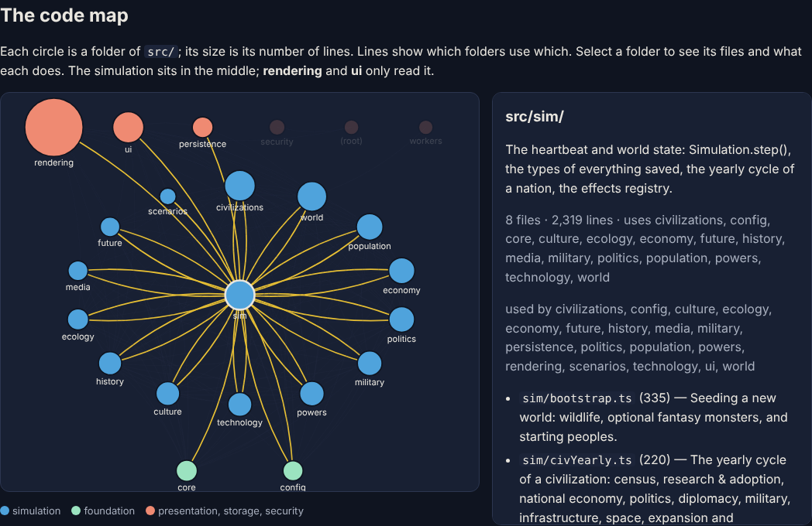

The diagrams below are [Mermaid](https://mermaid.js.org/). GitHub draws them; some other viewers show the source instead.

---

## Contents

1. [The game in one picture](#1-the-game-in-one-picture)
2. [The code base at a glance](#2-the-code-base-at-a-glance)
3. [The heartbeat: ticks, months and years](#3-the-heartbeat-ticks-months-and-years)
4. [The world: how a planet is made](#4-the-world-how-a-planet-is-made)
5. [The data model: where everything lives](#5-the-data-model-where-everything-lives)
6. [People](#6-people)
7. [Settlements and cities](#7-settlements-and-cities)
8. [Economy and jobs](#8-economy-and-jobs)
9. [Nations: technology, government, values, war](#9-nations-technology-government-values-war)
10. [Faith, culture, media, sport](#10-faith-culture-media-sport)
11. [Nature, climate and catastrophes](#11-nature-climate-and-catastrophes)
12. [God powers](#12-god-powers)
13. [History: events, statistics, feed and album](#13-history-events-statistics-feed-and-album)
14. [Determinism: same seed, same history](#14-determinism-same-seed-same-history)
15. [Saving and loading](#15-saving-and-loading)
16. [Drawing the world](#16-drawing-the-world)
17. [The interface](#17-the-interface)
18. [Tests, scripts and tools](#18-tests-scripts-and-tools)
19. [Build, CI and deploy](#19-build-ci-and-deploy)
20. [Where to start reading](#20-where-to-start-reading)
21. [Glossary](#21-glossary)

---

## 1. The game in one picture

EPOCH is a **god simulator**. A planet is generated from a seed. Small bands of people appear, and from then on history runs on its own:
- bands settle, farm, build cities and invent things;
- they form nations, trade, fight, believe, play sport, pollute;
- some reach space, and some collapse.

The player watches. Optionally, the player intervenes with **god powers**: raise mountains, start plagues, grant knowledge.

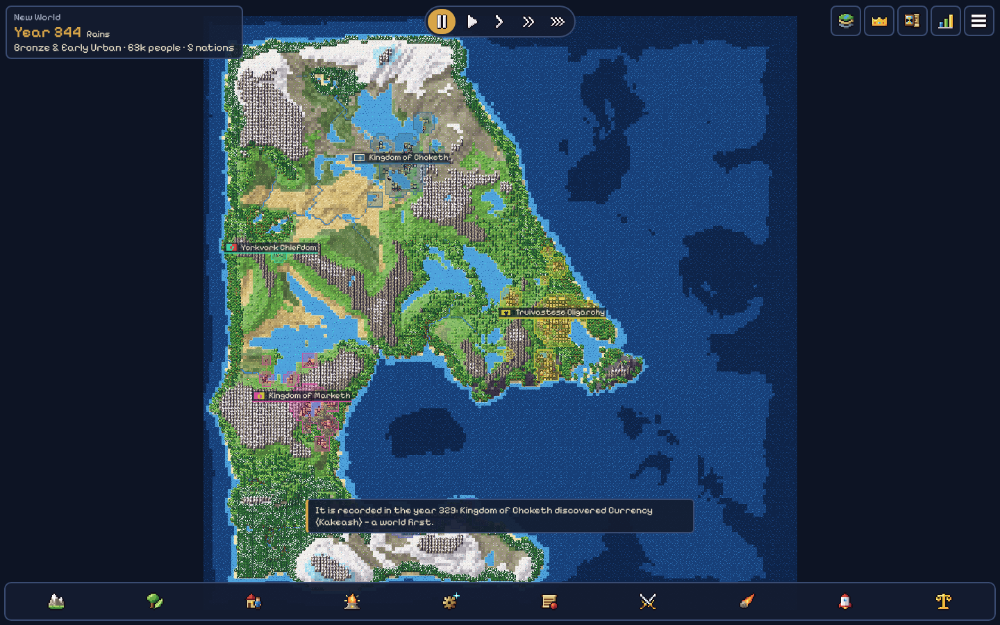

Three ideas run through the whole code:

| Idea | What it means in the code |
|---|---|
| **Everything is simulated, nothing is scripted** | No storyline. Cities are built because a planner measured a need, wars start because relations soured, and inventions spread through contact. Every number on screen comes from simulation state. |
| **Deterministic** | The same seed and the same god powers give the same history, bit for bit, on the same browser engine. All randomness comes from one seeded generator, and drawing never touches it. |
| **Separate the model from the picture** | The simulation (`src/sim`, `world`, `population`, `economy`, …) knows nothing about screens. The renderer and interface only read it. |

---

## 2. The code base at a glance

The project is TypeScript built with **Vite**. The interface uses **Preact** (a small React). The map is drawn with **Canvas 2D**. Tests use **Vitest** (unit) and **Playwright** (browser).

**Size** (from `node tools/guide-facts.mjs`, round 9): 142 source files, about 42,300 lines, and 42 unit-test files plus the browser e2e runner. Nearly half the lines are pixel art defined as code (`src/rendering/art/`).

```mermaid
flowchart TB
  subgraph Foundation
    core["core<br/>random numbers, noise, math, time"]
    config["config<br/>balance numbers, world laws"]
  end
  subgraph Model["The simulation (no screen code)"]
    sim["sim<br/>orchestration, world state, effects registry"]
    world["world<br/>map, terrain, generation, climate"]
    population["population<br/>people, demography, migration, disease"]
    civilizations["civilizations<br/>nations, settlements, cities, territory"]
    economy["economy<br/>production, markets, trade, jobs, traffic"]
    technology["technology<br/>207 techs, research, diffusion"]
    politics["politics<br/>government, diplomacy, succession"]
    military["military<br/>war, weapons, nuclear"]
    culture["culture<br/>religion, language, sport"]
    media["media<br/>news outlets, AI"]
    ecology["ecology<br/>animals, vegetation"]
    future["future<br/>space, existential risks"]
    history["history<br/>events, statistics, feed, album"]
    powers["powers<br/>god powers, undo"]
  end
  subgraph Outside["Around the model"]
    persistence["persistence<br/>save format, IndexedDB"]
    rendering["rendering<br/>map drawing, caches, pixel art"]
    ui["ui<br/>screens, panels, input"]
    security["security<br/>CSP, frame check"]
  end
  core --> sim
  config --> sim
  sim --> world & population & civilizations & economy & technology & politics & military & culture & media & ecology & future & history
  powers --> sim
  persistence --> sim
  rendering -. reads .-> sim
  ui -. reads, sends powers .-> sim
  ui --> rendering
```

Model folders call one another freely: a war changes the economy, and the economy changes politics. The rule that matters is the dotted line: **`rendering` and `ui` read the simulation and never change it.** The one exception is god powers, which go through `powers/` and are recorded.

| Folder | Files | Lines | What it is for |
|---|---|---|---|
| `rendering` | 29 | 18,300 | Everything you see on the map: chunk caches, close-up city blocks, effects, photos, and all the pixel art (as code). |
| `ui` | 23 | 2,900 | Preact screens (title, new world, settings, load), the game frame, panels (inspector, statistics, history, feed, laws) and touch input. |
| `civilizations` | 10 | 2,800 | Nations, settlements, the city planner (`urban.ts`), territory, values (ethos), missions, endings. |
| `world` | 8 | 2,500 | The tile map, terrain types, world generation, climate and environment, catastrophes, pathfinding. |
| `sim` | 8 | 2,300 | The heartbeat (`simulation.ts`), the world-state types, the yearly cycle of a nation, bootstrapping, the effects registry. |
| `population` | 9 | 1,600 | Individuals and age cohorts, births and deaths, the population ledger, migration, nomadic bands, disease, traits. |
| `economy` | 6 | 1,500 | Monthly production and jobs, national markets and finance, trade and roads, occupations, traffic, visitor accords. |
| `politics` | 4 | 1,400 | Government (institutions, policies), government forms, diplomacy, leadership and succession. |
| `military` | 3 | 1,200 | Armies and battles, weapons by era, nuclear weapons. |
| `powers` | 3 | 1,200 | The 108 god powers, fictional horrors (god mode only), undo for terrain strokes. |
| `technology` | 4 | 1,050 | The tech tree (207 techs, data), research, discovery, adoption, diffusion, loss, overtaking. |
| `culture` | 5 | 1,000 | Religion, culture drift, languages and names, sport leagues and world games. |
| `history` | 6 | 900 | Events with causes, statistics series, era-medium feed, headlines, the photo album. |
| `ecology` | 2 | 580 | Animal species, herds, predators, vegetation regrowth, monsters. |
| `core` | 5 | 570 | The seeded random generator (sfc32), noise, math helpers, a heap, time units. |
| `persistence` | 3 | 520 | The binary save format, validation of imported files, IndexedDB slots, migrations. |
| `config` | 2 | 430 | `balance.ts` (every tunable number in one place) and `laws.ts` (world settings and presets). |
| `media` | 2 | 410 | News outlets, polarization and misinformation, artificial intelligence. |
| `future` | 2 | 370 | Space programmes, colonies, and existential risks (lab-made plagues, rogue AI, grey goo). |
| `scenarios`, `security`, `workers` | 4 | 200 | Optional scenario goals, the CSP and frame check, and the world-generation Web Worker. |

---

## 3. The heartbeat: ticks, months and years

Time is cut into **ticks**: **one tick is about 3 days, and 120 ticks make a year.** The renderer never decides when the simulation moves. `Simulation.advance()` turns real time into a number of ticks for the chosen speed. It stops when its time budget (8 ms per frame) runs out, which keeps phones responsive.

Work is **staggered** so that no single tick is heavy:
- a settlement runs its monthly cycle on the tick where `settlement.id % 10` matches the tick in the month;
- a nation runs its yearly cycle on day `nation.id × 37 % 120`;
- world-wide yearly systems run on day 0.

```mermaid
sequenceDiagram
  autonumber
  participant Loop as Game loop (renderer)
  participant Sim as Simulation.step()
  participant Tick as Every tick
  participant Month as Monthly (staggered)
  participant Year as Yearly
  Loop->>Sim: advance(real ms, speed) → N ticks
  loop each tick
    Sim->>Year: day 0? → yearStart(): statistics, trade, religion, culture, sport, album, climate, catastrophes, risks, tech lead, notables
    Sim->>Tick: environment (fires, weather), herds, bands, agents, armies, monsters, a slice of vegetation
    Sim->>Month: settlements whose slot is now: economy → demography → construction → health & migration
    Sim->>Month: slot 0: climate (monthly), monsters
    Sim->>Year: nations whose day is now: census, research, market, politics, diplomacy, military, roads, space, expansion
  end
  Loop->>Loop: draw a frame from the current state
```

| How often | What runs | Where |
|---|---|---|
| Every tick | movement (bands, settlers, armies, herds, ships), battles, fires, weather | `sim/simulation.ts` `step()` |
| Monthly, per settlement | the economy (`economy/production.ts`), births and deaths (`population/demography.ts`), construction (`civilizations/urban.ts`), disease, migration | `civilizations/settlement.ts` `settlementMonthly()` |
| Yearly, per nation | census, research and adoption, the national market and public finance, politics, diplomacy, war, infrastructure, space, expansion | `sim/civYearly.ts` |
| Yearly, world-wide | statistics sample, international trade, religion, culture, sport, album, climate, catastrophes, existential risks | `Simulation.yearStart()` |

---

## 4. The world: how a planet is made

`world/worldgen.ts` builds a planet in eight seeded steps. It runs in a Web Worker (`workers/worldgen.worker.ts`) so the page does not freeze.

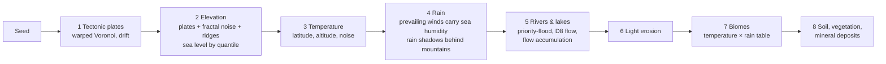

- **Noise** is seeded simplex noise (`core/noise.ts`) layered into fractal patterns.
- **Rivers** always run downhill. Depressions are filled first (priority-flood), each tile then points to its lowest neighbour (D8), and where enough rain gathers, a river appears.
- **Map shapes** (`world/mapShapes.ts`, 17 of them, such as Pangaea, archipelago and twin continents) steer steps 1–2 with a land mask.
- These are plausible patterns, not a geophysics model. `docs/MODEL.md` lists the simplifications.

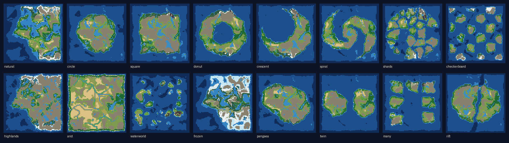

---

## 5. The data model: where everything lives

There is one **`WorldState`** object (`sim/types.ts`). Everything that matters for history lives in it, and it is what a save stores. The map is **data-oriented**: one typed array per attribute, indexed by `y × width + x`, instead of an array of tile objects. This is far faster and far smaller.

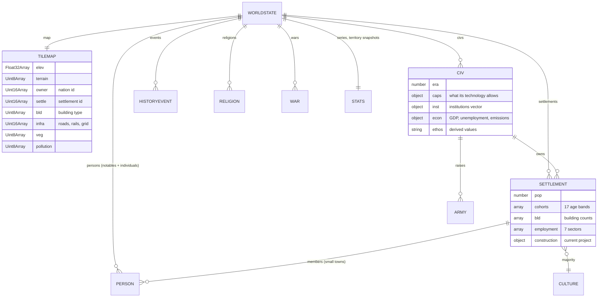

Next to `WorldState`, the running **`Sim`** context (`sim/context.ts`) holds things that are **never saved**:
- `rng`, the live random generator (its state *is* saved and restored);
- `chunkDirty` and `overlayDirty`, "redraw this part of the map" flags;
- `fx`, the queue of visual effects;
- `cache`, values derived from the world that can always be rebuilt.

That split is why saving and loading never changes the future.

---

## 6. People

People are simulated at **two resolutions** (`population/demography.ts`):

- **Individuals:** nomadic bands and villages under about 150 people. Every person is an object with genes, traits, a culture, a religion and parents. Couples form, children inherit, and family lines emerge.
- **Cohorts:** larger towns. People are kept as counts in **17 five-year age bands** (0–4 up to 80+). Each month, 1/60 of a band ages up, and births and deaths follow fertility and mortality schedules.
- **Switching:** a settlement switches between the two as it grows (above 150) or shrinks (below 60).

Mortality blends a pre-modern and a modern schedule according to health. Health comes from technology, health spending, nutrition and sanitation. Fertility falls with education, contraception and city life. Together these produce a **demographic transition**: deaths fall first, births later.

**The population ledger** (`population/ledger.ts`) records every person who enters or leaves a nation: births, deaths, famine, war, migration, conquest, and so on. Because the ledger is exact, the statistics can say *why* a population changed, and tests check that nobody is ever created or lost by accident.

Other parts of the folder:
- **notable persons** (rulers, generals, prophets) have life stories (`development.ts`, `persons.ts`, `traits.ts`);
- **mobile groups** (settlers, explorers, migrants, refugees, missionaries) walk the map (`agents.ts`);
- **disease** spreads between settlements with an abstract public-health model (`disease.ts`).

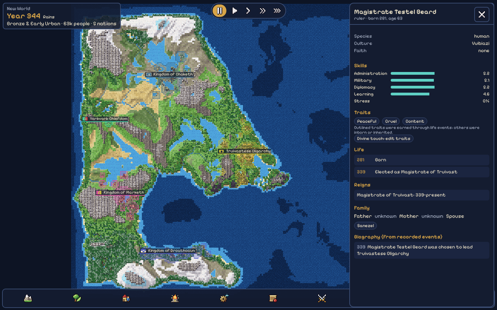

---

## 7. Settlements and cities

A **settlement** (`civilizations/settlement.ts`) is a town with its people, food, buildings and jobs. Each tile it controls holds at most one **district**: a building such as huts, a market, a factory or a park.

**The city planner** (`civilizations/urban.ts`) runs one construction project at a time per settlement:

```mermaid
flowchart TD
  N[Measure needs:<br/>housing pressure, food deficit,<br/>materials, jobs, energy, services,<br/>parks, renovation] --> C[Score every candidate building<br/>× nation's values (ethos) × current mission]
  C --> S[Sort by score]
  S --> A{Affordable?}
  A -- no --> W[Record the wish<br/>so traders can supply it] --> S
  A -- yes --> F{Find a site}
  F -- open land with street access --> P[Start project]
  F -- none --> R{Strong need?}
  R -- yes --> D[Redevelop: an era-obsolete district,<br/>or old low-density homes]
  R -- no --> S
  D --> P
  P --> B[Builders work monthly<br/>using materials from the national stock]
  B --> Done[District placed in the current era's style]
```

Rules the planner follows:
- **Street access** (round 6): homes, shops and civic buildings must keep an open neighbour, so cities have streets and room to breathe.
- **Parks** (round 7): cities aim for their era's real-world park share, and set aside one district in every few they develop as a park.
- **Renovation and building up** (round 7): out-of-date homes are rebuilt in the current style, and crowded cities replace houses with denser homes.
- **Composition** (round 8): in industrial eras, craft workshops stop growing with population, so factories, offices and homes take over.

**Territory** (`territory.ts`): each settlement projects influence over nearby tiles. Influence grows with population, culture and administration, and the strongest influence owns the tile.

---

## 8. Economy and jobs

The economy works in **physical units**: food, wood, stone, metals, coal, oil, electricity, goods, machinery, arms, electronics. Goods flow from districts into a **national stockpile** and back out to builders and households.

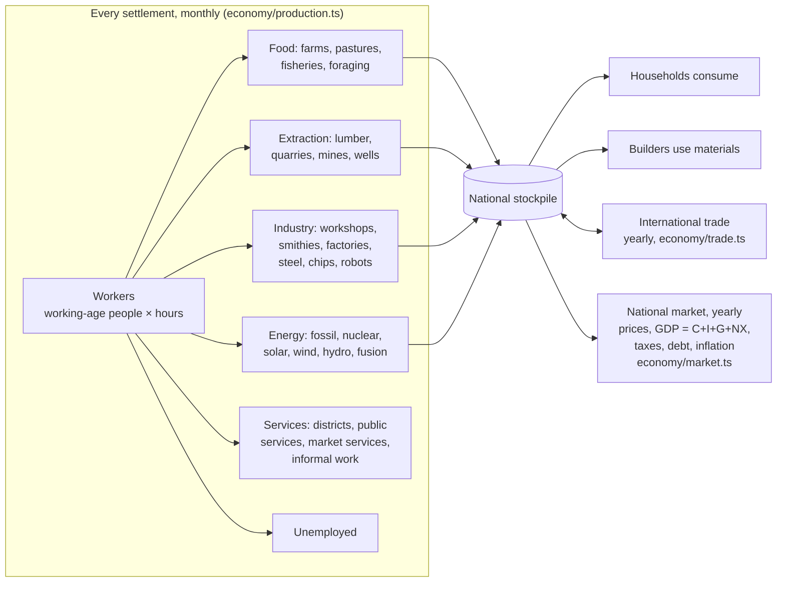

- **Labour:** working-age people are assigned to districts, and each district has jobs. Automation shrinks working hours and staff.
- **Services:** in industrial eras, market services grow with household goods income. Since round 8 there are also **public-service jobs** (teaching, health care, administration), which grow with welfare and with what the nation spends on schools and health. Since round 9, **elder care** adds care jobs in proportion to the people aged 65 and over (`careWorkersPerElder`), so ageing modern societies employ carers. Whoever is left does informal work or is unemployed.
- **Jobs** (`economy/occupations.ts`, round 7): the 7 sectors split into **41 named jobs**, from gatherers and smiths to programmers and AI supervisors. The split depends on what each place has and what each nation knows. Nations record the shares every year.
- **Roads** (`economy/trade.ts`): nations link their towns and upgrade the tiles along the way. Since round 7, route planning reuses roads they already built, so networks share trunk lines.
- **Traffic** (`economy/traffic.ts`, derived and never saved): vehicle trips per day are people × vehicles per 1,000 for the era × 2.5, measured against street capacity.

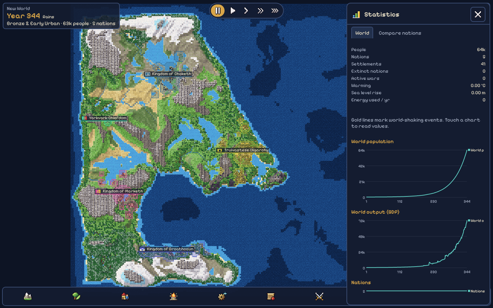

---

## 9. Nations: technology, government, values, war

**Technology** (`technology/`):
- **The tree:** 207 techs in a dependency graph across 15 eras (`techData.ts`). Each tech raises **capabilities** (`caps`), such as `farming`, `industry`, `computing` or `renewables`, which the rest of the simulation reads.
- **Spread:** a tech is researched, discovered or learned from neighbours, then **adopted** gradually, and it can be lost after a collapse.
- **Overtaking:** leapfrogging and sclerosis let a leader be overtaken (`overtaking.ts`).

**Government** (`politics/government.ts`):
- **Institutions:** a nation has a continuous vector (participation, liberties, capacity, welfare, religious authority, …). The government *form* (band, chiefdom, monarchy, republic, …) is a **label derived from** that vector (`govforms.ts`), not a switch.
- **Policies:** taxes, environment, migration, trade, conscription, UBI and AI regulation are set yearly from conditions. Since round 8, the environment policy also responds to global warming, and strict policy shifts steel to electricity and runs fossil plants only for demand clean power can't meet. Since round 9, a city short of power builds new plants faster the bigger the shortfall (`powerUrgency`), and a climate policy favours solar, wind, hydro and nuclear for those new plants (`cleanPowerStrictBonus`, half of it under the basic policy).

**Values and goals** (`civilizations/ethos.ts`, `missions.ts`):
- **Ethos:** derived each year from what a nation actually does, scored against the other nations, for example a militarist, mercantile, theocratic or ecological ethos. It multiplies building and research priorities.
- **Missions:** goals that emerge, such as "feed the people" or "reach space", with measured progress.

**War and diplomacy** (`politics/diplomacy.ts`, `military/`):
- **Relations:** relations hold opinion, trust and grievances. Treaties, alliances and ultimatums follow from them.
- **Armies:** armies are raised from working-age people, equipped from the arms stock and paid from the budget. Battles use a strength formula with terrain and doctrine.
- **Nuclear weapons:** these have programmes, deterrence, escalation, fallout and nuclear winter.

**Endings** (`civilizations/endings.ts`): nations end through typed pressures (famine, war, disease, AI takeover, …), and each nation's end is recorded.

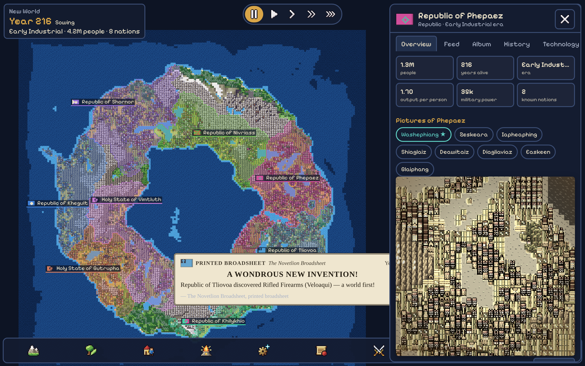

---

## 10. Faith, culture, media, sport

- **Religion** (`culture/religion.ts`): faiths are founded by prophets, spread along contact, split into schisms, become state religions, and fade with secularization.
- **Culture and language** (`culture/culture.ts`, `language.ts`): cultures drift apart or blend. Each language has its own sounds, and every name in the game is generated from them (`naming.ts`). A list of real brands is blocked.
- **Media and AI** (`media/`): news outlets appear in the medium of the era, from chronicles to broadsheets, radio and social platforms. Polarization, misinformation and trust are simulated, and so are AI systems with capability and alignment.
- **Sport** (`culture/sports.ts`): leagues form in each nation, champions are crowned, and world games are held. The sport played follows the era.

---

## 11. Nature, climate and catastrophes

- **Ecology** (`ecology/`): animal herds graze, breed up to what the vegetation supports, are hunted by predators (Lotka–Volterra-style) and can go extinct. Vegetation regrows towards what each tile's soil and climate allow.
- **Climate** (`world/environment.ts`):
  - **Warming:** nations' emissions raise CO₂, and warming follows CO₂ with a lag, so sea levels rise.
  - **Tipping point:** past 3 °C the climate releases CO₂ by itself. Since round 8 that store is finite: before, it was unlimited, so warming ran away whatever nations did.
- **Catastrophes** (`world/catastrophes.ts`): supervolcanoes, asteroid impacts, solar superflares and gamma-ray bursts occur at real orders of magnitude, so rare things stay rare.

---

## 12. God powers

`powers/powers.ts` defines **108 god powers** in 9 groups: terrain, nature, peoples, faith and culture, technology, politics, warfare, disasters, modern and future.
- **Real changes:** each power changes real state (terrain, people, institutions, technology, relations) and is recorded in `interventions`, so a timeline can be replayed.
- **Undo:** terrain strokes can be undone (`undo.ts`).
- **Observer worlds:** the "Realistic" preset turns all powers off.

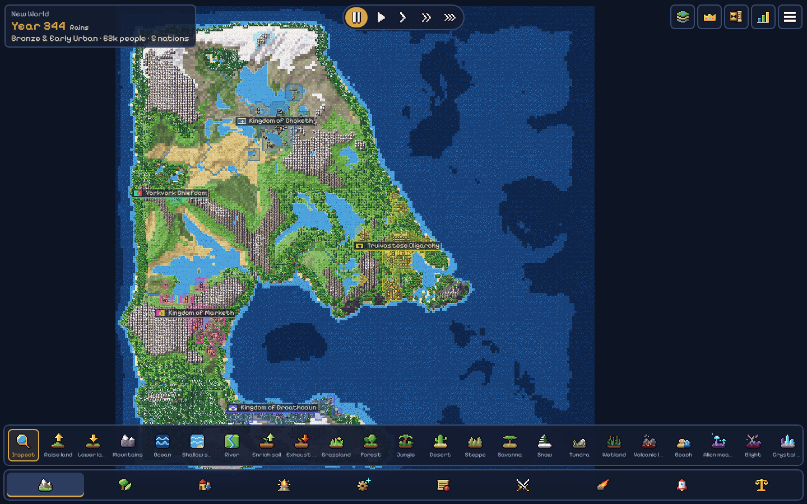

---

## 13. History: events, statistics, feed and album

- **Events** (`history/events.ts`): every meaningful development becomes a `HistoryEvent`. It records the people, places and nations involved, a map position, an importance level, and weighted **causes** (for example "famine, 60%; war, 40%"). Each event also triggers its map effect (see [Drawing](#16-drawing-the-world)).
- **Statistics** (`history/stats.ts`): sampled yearly for the world and every nation. Long histories stay bounded by thinning old samples. Territory snapshots are taken every 25 years for the "past borders" layer.
- **Feed** (`history/feed.ts`, `feedFrame.ts`, `newspaper.ts`): what people of the time read, built from recorded events, never invented. It might be a cave wall, a town crier, a newspaper or a social feed.
- **Album** (`history/album.ts`): every 50 years each nation's capital is recorded as a compact layout. Its postcard and aerial photo are redrawn from that layout later.

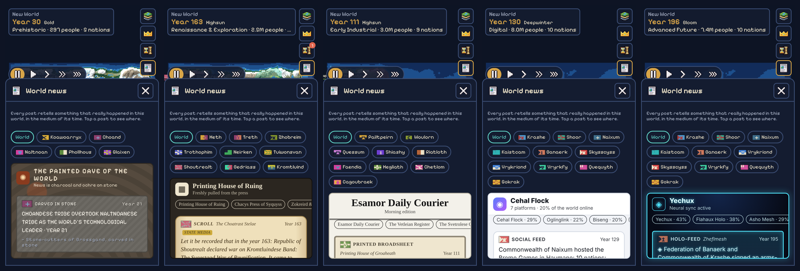

---

## 14. Determinism: same seed, same history

How it works:
- **One random generator:** all randomness comes from `sim.rng`, an **sfc32** generator (`core/rng.ts`) with 128 bits of state.
- **Seeding:** the seed text is hashed (cyrb128) into the four starting numbers.
- **Saved state:** the generator's state is saved with the world, so a loaded save continues the same random sequence.

What keeps it deterministic:
- **Drawing never uses `sim.rng`.** Visual variety, such as which tree sprite appears on a tile, comes from `hash3(x, y, salt)`, a pure hash of the position.
- **Effects are visual only.** They live in `sim.fx`, which is never saved.
- **Fixed order:** systems always run in the same order, and staggered work is keyed by ids. Sets that need ordering are sorted before use.
- **Proof:** tests run worlds twice, or save, load and continue, and compare `Simulation.digest()` or the save bytes.

One honest limit: integer random numbers are identical everywhere, but values that pass through `Math.log` or `Math.cos` can differ in the last digit between JavaScript engines. Reproducibility is therefore guaranteed on the same browser engine, not bit for bit across all browsers.

---

## 15. Saving and loading

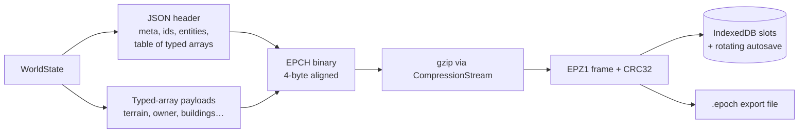

- `persistence/serialize.ts` encodes and decodes. Decoding treats every file as **untrusted**:
  - output is size-capped while decompressing;
  - array ranges and lengths, ids, colours and statistics are all checked;
  - every failure is a typed `SaveError`.
- `persistence/saves.ts` keeps slots, thumbnails and branches in IndexedDB. `persistence/migrations.ts` upgrades older save versions.
- Fields added in later rounds are optional, so older saves still load.
- **Devices** (round 9, `persistence/device.ts`): each browser gets a private random id (stored in `localStorage`, never sent anywhere) and a name read from the browser's user agent, such as "iPhone · Safari", which you can rename in Settings. Every save and export stamps the device that made it into `meta.devices` (the last 8, newest first). The Load screen groups worlds as "Started on this device" first, then by the device each world began on, and shows "also saved on …". The simulation never reads these fields, so they cannot change history.
- **Favourites** (`sim/favorites.ts`) are saved in `meta.favorites` the same way: a list of up to 50 places, nations, people, armies, bands and herds.

---

## 16. Drawing the world

Each frame, `rendering/renderer.ts` draws back to front:

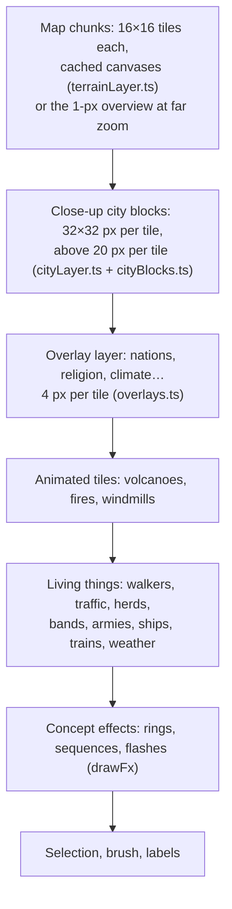

**Caching** is what makes this fast enough for phones:

| Cache | How it stays correct |
|---|---|
| **Map chunks** (16×16 tiles, LRU of 220) | When the simulation changes something drawn, it calls `markTile(i)`. That sets `sim.chunkDirty` for the tile's chunk, and for the chunk next door if the tile is on an edge, because neighbours read it (road joins, shores, shading). The renderer redraws a few dirty chunks per frame, nearest first. |
| **Overview and overlays** (round 7, after WorldBox) | Pixel buffers in which only the changed 16×16 zones are rewritten (`pixelCache.ts`). Live overlay modes also refresh a rolling quarter of the map each pass. On a 512² world this cut the pixel work per pass from 6.6 to 0.7 ms (overview) and from 14.7 to 2.1 ms (overlay), measured as Node CPU time. |
| **Close-up blocks** (8×8 tiles, at most 48 chunks) | Follow the same dirty flags, plus a yearly signature check per tile, which catches changes in a city's wealth, values or park share. |
| **Tinted sprites** | Each sprite is coloured in a nation's colours once, then reused. |

A test, `cacheFreshness.test.ts`, runs every god power and 30-year histories from three eras. It checks that every tile whose look changed was marked for redraw. When it was written in round 7, it found 9 kinds of change that would have left the map stale.

**Close-up cities** (`cityBlocks.ts`, pure functions):
- **Input and output:** one district's data goes in, and a 32×32 plan comes out: streets, plots, yards, trees and amenities.
- **Streets:** sized to real-world street shares by era.
- **Homes:** 16 forms (cottages, villas, terraces, high-rises, eco-pods…), chosen by district type, era, wealth and inequality.
- **Roads:** simulated roads become arterials or divided highways.

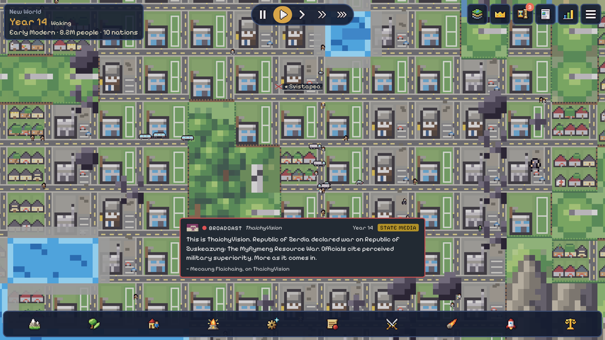

**Close zoom, WorldBox-style** (round 9, `rendering/closeup.ts`): past 20 px per tile the map stops scaling its actors up with the camera. People, animals, armies and vehicles keep a readable on-screen size (`readableScale`), so a close view shows many small figures, not a few giant ones.
- **Real people:** small towns (individual mode) draw their actual living residents, at most 40 of them. The sprite comes from their role (ruler, general, priest…), then their age (children are smaller), then their job.
- **Big cities** (cohort mode) draw their notables, each marked with a small star, plus a crowd sampled from the city's real employment mix.
- **Tapping a figure** opens that person in the inspector.
- **Herds** show more animals, more spread out, up close. Wandering bands draw their real members.
- **City details:** smoke wisps rise from industry (never from solar or wind plants), and flags fly over palaces, temples and universities.
- Under **Reduce motion**, people stand still.

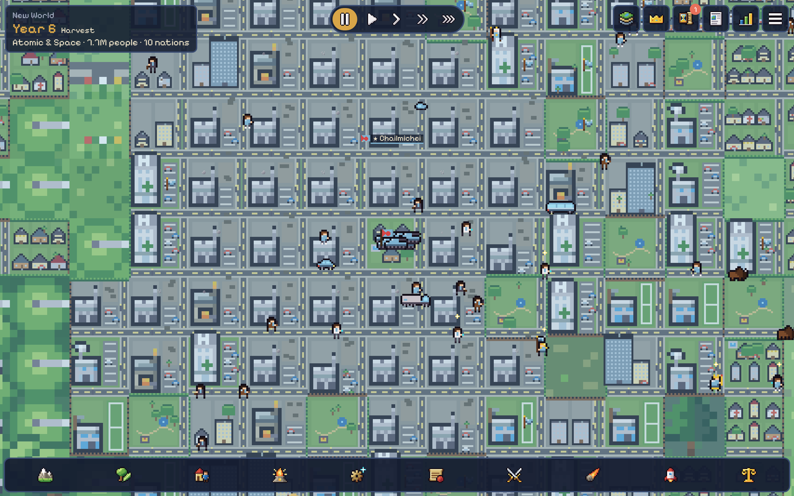

**Follow camera** (round 9, `ui/game/Game.tsx`): the inspector's *Follow* button keeps the camera on a person, army, band, herd, town or nation each frame. Dragging the map stops following; zooming does not. The ★ button adds the selection to Favourites in the game menu. The keys `+` and `-` zoom at the centre of the view.

**Concept effects** (`sim/conceptFx.ts`): one registry decides what every god power and every event type shows on the map (a quake ring, a meteor that falls and explodes, fireworks for world games). Every entry is either an effect or a written reason for having none, and a test checks the registry covers everything. Under **Reduce motion**, effects become still markers and the screen never flashes.

**Pixel art** (`rendering/art/`): all sprites are defined in code as rows of palette letters. `atlas.ts` rasterizes them into canvases once at start-up, so the game needs no image files.

---

## 17. The interface

`ui/` is a small Preact app:
- **Screens:** title, new world, settings, load.
- **Game frame:** top bar, playback controls, the god-power dock.
- **Sheets:** inspector (tile, settlement, nation, person, religion), statistics, history, the feed, map layers, laws, menu.

Panels read the simulation directly and refresh as it runs. Input (`ui/input.ts`) handles touch and mouse: tap, drag, pinch-zoom and brush strokes. Design tokens in `styles.css` set spacing, a 12-px text floor, 44-px touch targets, and motion tokens that are switched off under Reduce motion.

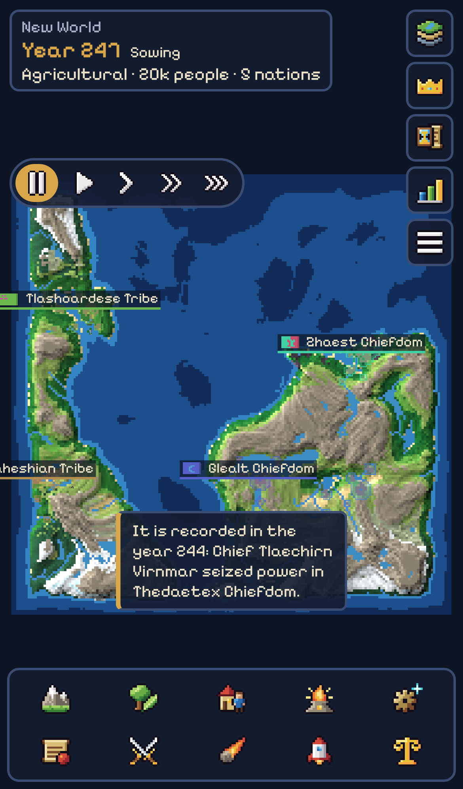

---

## 18. Tests, scripts and tools

### Tests (`tests/`, 40 unit-test files; `npm test`)

| Suite | What it proves |
|---|---|
| `sim/` | Determinism (same seed, same digest), every concept's map effect, the effects never change history. |
| `world/` | Map shapes, generation, fires and saves, undo. |
| `population/` | The ledger balances exactly; fertility transition; refuge populations. |
| `civilizations/` | The planning rule, parks, renovation, round-8 composition, public jobs and climate policy. |
| `economy/` | GDP identity, unemployment mechanics, the jobs split. |
| `technology/`, `culture/`, `media/`, `ecology/`, `history/` | Each system's rules and counterfactuals, e.g. "the same world without X behaves differently in the expected direction". |
| `persistence/` | Save round-trips, corrupted and malicious files are rejected. |
| `security/` | CSP, framing, pinned CI actions, the Pages deploy gate. |
| `rendering/` | Block composer, caches (incremental equals full rebuild), cache freshness, sprites. |
| `integration/` | Long multi-system scenarios. |
| `e2e/run-e2e.mjs` | A real browser (Chromium) runs the production build on phone, desktop and Reduce motion: 62 checks, including the close-up city, jobs, effects, this guide's page, saves, CSP and framing. |

A **counterfactual** test is the main tool for checking cause and effect. It clones a world, changes one thing, runs both copies, and checks that the difference goes the right way.

### Scripts (`scripts/`, run with `npx tsx`)

| Script | What it does |
|---|---|
| `run-sim.ts` | Runs one world headless and prints progress every 25 years (population, nations, era, wars, ms per year). |
| `modernization.ts` | Runs 1,000 years with no god powers. Records the year the leading nation reached each era, its indicators every century, and every natural hazard. This is the main balance check. |
| `multi-seed.ts` | Runs 20 worlds × 600 years and checks the invariants (the ledger balances, all values are finite, the GDP identity holds), plus era and speed. |
| `endings-census.ts` | Counts how nations end across many worlds. |

### Tools (`tools/`)

| Tool | What it does |
|---|---|
| `guide-facts.mjs` | Produces the facts for this guide and its interactive page (files, lines, descriptions, import graph). |
| `balance-compare.mjs` | Compares two sets of `modernization.ts` runs: milestone shifts, unemployment and warming. |
| `viewports.mjs` | Opens the game on 6 device profiles and enforces text ≥ 12 px, touch targets ≥ 44 px and WCAG AA contrast. |
| `design-capture.mjs` | Takes about 120 screenshots across devices and measures text size, touch targets, contrast and motion. |
| `perf-closeup.mjs` | Frame times of the close-up city, with the CPU throttled. |
| `render-sprites.ts`, `contact-sheet.ts` | Export the pixel art to PNG and make a sprite contact sheet. |
| `gallery*.mjs`, `screenshot.mjs`, `guide.mjs` | README screenshots and annotated "what's on screen" images. |

### Benchmarks (`benchmarks/`)

`sim-bench.ts` (simulation speed), `browser-bench.mjs` (frame times in Chromium), and `pixel-cache.ts` (zone caching against full rebuilds).

---

## 19. Build, CI and deploy

```mermaid
flowchart LR
  Dev[Push to GitHub] --> CI[CI workflow<br/>typecheck · unit tests · build ·<br/>browser e2e (Chromium + WebKit)]
  CI -- green --> Pages[Pages workflow<br/>runs on CI success only,<br/>builds the exact tested commit]
  CI -- red --> Stop[Nothing deploys]
  Pages --> Live[jviola1019.github.io/worldsim]
  Sched[Weekly schedule] --> Long[Long-run validation<br/>1,000-year runs]
```

- `npm run build` runs `tsc` then `vite build`, producing the static site in `dist/`.
- **Browser e2e** (`tests/e2e/run-e2e.mjs`): runs on Chromium, and since round 9 also on WebKit, Safari's engine (`BROWSER=webkit`), each with iPhone 13 emulation and a desktop window. This is emulation, not a physical iPhone.
- **Security on GitHub Actions:**
  - every action is pinned to a full commit hash;
  - jobs read the repository by default, and only the Pages deploy job can write, and only to Pages;
  - a security test checks all of this.
- **On the live site:** a Content Security Policy limits scripts to the game's own files, and the game refuses to run inside another site's frame.

---

## 20. Where to start reading

1. `src/sim/simulation.ts`: the heartbeat, about 190 lines.
2. `src/sim/types.ts`: the shape of the world.
3. `src/civilizations/settlement.ts` → `src/economy/production.ts` → `src/civilizations/urban.ts`: one town's month.
4. `src/sim/civYearly.ts`: one nation's year.
5. `src/rendering/renderer.ts`: one frame.
6. `src/config/balance.ts`: every tunable number, with notes on where it comes from.

The rest of `docs/` goes deeper:
- `ARCHITECTURE.md`: design decisions and the data dictionary;
- `MODEL.md`: the scientific basis and simplifications;
- `VALIDATION.md`: every measured result, round by round;
- `STATUS.md`: what is complete and the known issues;
- `SECURITY.md`: the threat audit.

---

## 21. Glossary

| Word | Meaning here |
|---|---|
| **Tick** | One simulation step, about 3 days. 120 per year. |
| **Cohort** | A five-year age group counted as a number instead of individuals. |
| **Caps (capabilities)** | What a nation's technology allows, e.g. `industry: 1.2`. Systems read these instead of tech names. |
| **District** | The building on one map tile (huts, a market, a factory). A tile is about 10 km across. |
| **Chunk** | A 16×16-tile block of the map drawn as one cached image. |
| **Dirty flag** | "This chunk changed; redraw it." |
| **Deterministic** | Same inputs → same outputs, every time. |
| **Digest** | A fingerprint of the world state, used to prove two runs are identical. |
| **Counterfactual test** | Run the same world twice with one difference, and check the effect. |
| **Ethos** | A nation's derived values (militarist, mercantile, ecological…). |
| **Ledger** | The exact record of every person entering or leaving a nation. |
| **Era / tier** | 15 technology eras; 8 architectural style tiers derived from them. |
| **Merit-order dispatch** | Using the cheapest or cleanest power first and fossil plants only for the remainder (round 8). |
| **CSP** | Content Security Policy: browser rules that stop injected scripts. |
